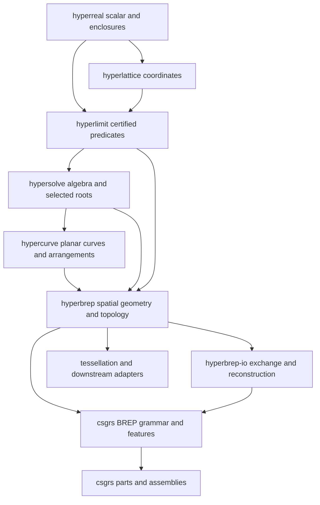

# HyperBRep development plan

Status: implementation blueprint. Updated 2026-10-16 for upstream
`72cd216cc758d364c9e40b8969fef2df155bec8b` and concurrent development ownership.

HyperBRep should become a pure Rust, native and WebAssembly CAD kernel for
exact boundary modeling, general Booleans, sweeps, lofts, fillets, shelling,
and STEP exchange. The critical path is to make intersection results remain
representable through trimming, topology construction, validation, editing,
and persistence. Adding more primitive formulas without that closure would
continue the current pattern of specialized operations whose results cannot
always participate in the next operation.

The [repository audit](REPOSITORY_AUDIT.md) records the inspected baseline,
all surrounding crate responsibilities, external reference revisions, and
existing CI obligations. The
[algorithm research](ALGORITHM_RESEARCH.md) records primary-source findings,
feasibility limits, implementation experiments and decisive prototype gates.
It distinguishes reviewed methods from candidates still needing a proof or
implementation audit; published performance is not a HyperBRep benchmark.
The current
[architecture](ARCHITECTURE.md) and [support matrix](SUPPORT_MATRIX.md)
describe implemented behavior. This plan describes work to perform; proposed
APIs and paths below do not already exist.

Implementation progress is recorded in
[IMPLEMENTATION_STATUS.json](IMPLEMENTATION_STATUS.json), linked from the
project property ledger. Development is greenfield: update callers directly
when APIs or archives change; do not build compatibility shims or maintain
parallel legacy interfaces.

## Agreed direction

The following choices came from the project owner:

1. Prioritize general CAD modeling: Booleans, fillets, shelling, sweeps and STEP.
2. Preserve exact authoritative topology. Fitting, healing and approximations
   must be explicit operations with their own contracts.
3. Permit a clean break in public APIs and saved models.
4. Keep the production kernel and STEP implementation pure Rust and usable
   on native platforms and WASM. External kernels are optional test oracles.
5. Include feature history, sketch-to-solid workflows and assemblies as
   downstream layers with explicit ownership.

The remaining defaults in this plan are engineering decisions: immutable
models, manifold volume bodies plus explicitly typed sheet/wire geometry,
AP242 geometry and basic assembly exchange first, and bounded strict
operations that fail explicitly when a proof cannot be completed. They do
not require another product decision before foundational implementation.

The requirements in [properties.md](../../../properties.md) govern this plan.
The [admission protocol](../../../docs/admission.md) is their single normative
extension protocol: **exactness > completeness > performance > memory >
binary size > source size**. A lower-rung improvement cannot demote a higher
one. Each extension declares its domain, proof, composition closure, resource
units, failure vocabulary and validation evidence. Current accepted ADRs
remain binding until the specific amendments below land with their types
and tests. The permitted API/archive break does not authorize loss of an
existing exact capability or its replay evidence.

### Implementation scope and concurrent development

The project owner directs this branch's further implementation to
`crates/hyperbrep`, `crates/hyperbrep-io`, and their tests, benchmarks and
documentation. Surrounding crates are being developed concurrently in another
thread. Their responsibilities remain in this architectural roadmap, but
unrelated dependency repairs are not implementation tasks for this branch.

Change a surrounding crate only when leaving it unchanged would make BREP
incorrect, lose supported behavior or evidence, or violate a demonstrated BREP
resource/performance contract. Reproduce the concrete BREP failure on the
current revision, check for an upstream correction, and make only the necessary
owning-layer change. Preserve typed blockers for genuinely unsupported work;
do not duplicate another kernel or resume a parked dependency prototype merely
because it exists. Report unrelated dependency findings for upstream ownership.

Expect further merges. Occasionally fetch upstream at coherent work boundaries,
especially before establishing a new baseline or diagnosing a dependency
problem. Preserve local work and both histories, review conflicts against the
latest upstream intent, and update BREP callers directly. Requalify the affected
native, feature, WASM and composition paths after integration. Keep a fixed
revision throughout checks and matched measurements; refresh source-specific
evidence before making claims on the merged code.

Future sketch/infill consumers must retain the upstream gear, rack and airfoil
constructors' typed failures and contextual `GeometryOutcome` receipts. Their
sampled profiles retain sampled intent; successful strict construction does
not establish fidelity to an analytic gear or airfoil. Consume the authoritative
`hilbert_paths_with_context` trim records when source parameters, contacts and
selected intervals are required. Do not reconstruct this evidence from the
geometry-only strings. Padding insets the Hilbert grid bounds; it is not a
boundary-clearance guarantee. These APIs remain CSGRS/Hypercurve responsibilities;
BREP consumers compose them without duplicating the curve kernel.

The [latest integration record](evidence/2026-10-16-upstream-corrections/README.md)
records the two grammar corrections, unchanged BREP/dependency implementations,
retained executable identities and merged-source qualification. Separately
pending native work mentioned in upstream evidence is not admitted by a merge
that does not contain it. The previous parked scalar investigation remains
preserved and unapplied.
This ownership direction changes who performs dependency work; it does not
weaken the shared properties or close any work-package gate.

## Properties and acceptance obligations

This mapping applies the existing properties; it does not create another
admission specification. `P1`–`P39` are property IDs, `T1`–`T14` are the known
open-target IDs, and `WP00` onward identify this plan's work packages.
The existing [execution ledger](../../../docs/properties-status.json) retains
project-wide status and evidence. Link BREP work-package records to it;
writing this plan does not verify or close a property or target.

| Properties | Required application and evidence |
| --- | --- |
| P1–P3 | Preserve exact authored values and symbolic structure; use certified structural facts; structural inequality or `Unknown` is never geometric disjointness. See [scalar contracts](#scalar-retained-geometry-and-proof-contracts). |
| P4 | Cache warming, eviction, policy and precision changes preserve every available certificate and value contract. Exercise the explicit cache-state matrix in [performance and resources](#performance-resources-and-reproducibility). |
| P5 | Bound coefficient/expression growth at the earliest sufficient layer. Distinguish precision, total work, retained memory and cancellation; test exhaustion, cleanup and recovery. Disclose absent bounds and externally contain dangerous tests. |
| P6–P7 | Propagate ordinary numeric `Problem` values without panic; distinguish successful empty geometry from invalid, unsupported, undecided, exhausted and unbounded outcomes through every consumer. Reuse stable Hyperreal primitives and fused reducers. |
| P8–P11 | Keep policy and proof scope explicit. Bind local certainty to the claim and evidence actually consumed; retain inherited qualification separately. Reuse admissible strict proofs across policies; neither policy selection nor a cache hit alone upgrades a claim. |
| P12–P13 | Use `CurveRegion2` for all planar filled regions and chart arrangements; winding and the declared fill rule determine material/hole roles without author orientation hints. |
| P14–P16 | Preserve provisional/uncertain receipts through composition and adapters; every output boundary retains source and contact evidence; promotion never consumes display chords as exact geometry. |
| P17 | Independently derived expectations and regularized-set identities establish semantic equality with stated preconditions. Matching counts, checksums or wrappers around one kernel alone cannot establish the intended set. |
| P18 | Every supported result remains an operand when composition is defined, including empty, disconnected, holed and symbolic geometry. Exercise accumulation from empty and complete subtraction; shortcuts must not hide malformed operands. |
| P19 | Preserve selected-root/fiber identity, signs, parameters and dependency certainty through edits, persistence and replay. A strict operation on a quantized mesh does not certify fidelity to the original source. |
| P20 | Bound and measure repeated-operation growth; precision and entry counts are not total-work or heap-byte bounds. Exhaustion precedes publication; partial results need an explicit provisional contract. |
| P21–P22 | Preserve Hypermesh's broad closed-PWN contract and one shared arrangement across expression roots. BREP's manifold contract is a separate carrier contract; conversions diagnose unsupported topology without narrowing Hypermesh. |
| P23–P24 | Reject exterior-containing results as `UnboundedBooleanOutput`; use exact coincidence and retain small but distinct gaps and features. |
| P25–P27 | Fix invariants in the lowest owning layer and share enforcement. Keep the primary modeling path fallible; expose format-specific loss. Test semantic equality separately from deterministic artifacts and identify representation migrations separately from performance-only work. |
| P28–P30 | Validate hostile inputs and ownership, catch boundary panics, and expose certainty, provenance and typed failures through real ABI consumers. Successful empty geometry remains distinguishable from failure. |
| P31–P34 | The [machine and community interfaces](#machine-and-community-interfaces) require certified demotion, fail-closed bounded machine IR, replayable jobs and exact OpenSCAD numeric ingress. Ownership remains downstream. |
| P35 | Retain minimized and original full-resolution failures. Never obtain a pass by weakening policies, accepting a new Unknown, omitting difficult geometry or reducing resolution. Explicit migrations are not fixes under the original contract. |
| P36 | Compare the same completed contract, including provenance, certainty, validation and materialized output. Retain source/dependency/toolchain/hardware/input/policy/cache/timing records, unfavorable samples, and supported-corpus regressions. |
| P37 | Scope claims to evidence. Source integration or a ledger edit does not establish admission. Delivery requires a clean external consumer of the documented package, including its downstream pipeline, features, MSRV and affected bindings. |
| P38 | Run representation-specific lexicase campaigns with ASan, dispatch tracing and competitive benchmark gates, retaining selection scores and failures. |
| P39 | Measure capability by completed, validated named workflows; report certified, qualified approximate, undecided, unsupported, invalid, exhausted and incorrect results separately. Preserve the certified-success corpus individually. |

### Acceptance order after the upstream integration

The [integration record](evidence/2026-10-15-upstream-integration/README.md)
identifies the merged revisions, checks and remaining gaps. It supplements
the historical audit rather than relabeling its old observations as current.
The root [agent rules](../../../AGENTS.md), properties and admission protocol
apply to each subsequent patch; these application notes do not replace them.

1. **Empty-result composition and visible failures.** Reproduce gaps on the
   target source, identify the owning layer and missing acceptance test, then
   implement the smallest coherent repair. The integration baseline's Boolean
   front doors took two `SolidRef` values and could not consume empty results.
   The [BodySet increment](evidence/2026-10-15-body-set/admission.md) changes
   the public operand/result contract and exercises empty/disconnected/overlapping
   selections through further operations. Preserve those successes and extend
   full geometric and evidentiary closure before treating additional primitive
   or exchange cases as workflow completion.
   Audit error propagation through builders, queries, persistence, adapters
   and bindings at the same time; no failure becomes empty, false, zero,
   unchanged input or incomplete success.
2. **Ordinary strict-mode completion.** Maintain named recipes for drilled
   bodies, transformed primitives, profile extrusion, holes, repeated cuts,
   touching/coplanar surfaces and supported symbolic coordinates. Each recipe
   must consume previous outputs and check the intended set, topology and
   source relationship separately. Preserve every certified success; record
   the exact failing operation and typed reason for incomplete workflows.
   Observe the upstream polygonal drill corpus during dependency integration,
   including its full-resolution 16/32-segment compositions. Further repairs to
   that root modeling path belong upstream unless a reproduced failure blocks
   or regresses BREP. BREP's own strict workflows remain this branch's
   implementation and acceptance obligations.
3. **Complete user-path and release validation.** Exercise the documented
   distribution in a clean project: install, construct, transform, compose,
   inspect certainty, validate topology, export, reimport and check the
   format-specific contract. A path-dependent workspace probe or WASM runtime
   test is useful local evidence, not proof of an installed release. Record
   absent packages, feature/MSRV coverage and binding gaps honestly.

For every construction and conversion, record **numerical certainty**,
**topological validity** and **geometric fidelity** as distinct claims. A
validated sampled mesh is not thereby the exact analytic surface; a certified
predicate is not a manifoldness proof. Approximate construction followed by
strict transform, Boolean, export, import and validation retains its original
qualification unless a new proof establishes the particular source claim.

Before implementation, record the domain, owning layer, relevant properties,
affected consumers, missing/failing test, witness, resource units and outcome
vocabulary. After the final edit, run affected local and downstream checks;
link raw evidence and limits. Upstream changes invalidate source-specific
qualification for the new candidate: preserve historical logs, reproduce on
the integrated revision and establish fresh matched baselines before cost
claims. Performance work serves these acceptance milestones; it does not
replace them. All work packages and research gates remain in scope.

All fourteen known open targets remain in scope. Already verified ledger
entries must be preserved and extended to new BREP paths, not treated as
evidence for paths that do not yet exist.
A historical verified label applies to its recorded source and domain;
revised criteria require fresh evaluation and explicit remaining gaps.

| Target | Ownership and planned completion evidence |
| --- | --- |
| T1 Cache policy | Extend explicit modeling-cache semantics to BREP, prepared operands and feature evaluation; document budget units and test cold/warm/reset/policy transitions. |
| T2 JS certainty | Preserve the existing certainty surface and add BREP query, error and artifact receipts with actual JS/WASM consumer tests. |
| T3 Curve work budgets | Hypercurve/Hypersolve own reusable budget propagation; BREP shares explicit work charges and distinguishes exhaustion from undecided predicates. |
| T4 Admission specification | Keep `docs/admission.md` normative; link admission records instead of duplicating weaker per-crate rules. |
| T5 Terminology | Review public names across the stack against established mathematical/CAD terminology; retain one narrow vocabulary for equivalent operations. |
| T6 Exhaustive testing | Retain the 100% coverage target with measured gaps, representation/dispatch matrices, independent lexicase buckets, ASan and competitive comparisons; track Verus coverage for Hyperreal, Hyperlattice and Hyperlimit and historical comparison revalidation. |
| T7 Idiomatic bindings | Provide and exercise C/C++, Python and JavaScript/TypeScript APIs with ownership, errors, exact inputs and certainty appropriate to each language. |
| T8 CI and site | Extend the complete workflow matrix, native/WASM demos and project static-site build; document genuinely unavailable hosted steps. |
| T9 Documentation | Follow Hyperreal/root csgrs examples: purpose, rationale, quick start, public type/function index and educational rustdoc linked to deeper references. |
| T10 Paper | Prepare a publication/education manuscript with a claim-to-evidence index distinguishing proofs, measurements and open questions; revalidate imported claims before citing them as results. |
| T11 Optimization | Maintain idea ledgers and evaluate combinations of prior ideas; measure exact-preserving SIMD/threaded paths, including `fearless_simd` as a candidate, under the governing ladder. |
| T12 Release | Maintain a readiness record for every monorepo crate, including excluded workspaces; satisfy packaging, dependency, feature, documentation, license and binding requirements before each release claim. |
| T13 File organization | Split and combine modules by responsibility, with navigable sizes and indexes; keep public APIs thin and avoid empty scaffolding. |
| T14 Future work | Complete and follow the crate-specific future-work inventory in the execution ledger; assign every item an owner, evidence requirement and dependency without dropping it from scope. |

The first CAD release is a product milestone within this broader program.
It must satisfy every applicable property for its admitted paths. It cannot
be presented as completion of all crate future work, whole-stack formal
verification, machine integration, paper preparation or every crate's release.
The cross-cutting work packages below retain those obligations explicitly.

## Release scope and completion

The complete roadmap has three delivery levels. These are dependency gates,
not calendar estimates; generic algebraic intersections and offsets contain
substantial algorithmic risk that must be measured before scheduling dates.

| Level | Required result |
| --- | --- |
| Foundation | Existing exact behavior retained; model-safe identity; retained algebraic endpoints; chart-aware topology; replayable certificates; general curved-shell validity; bounded operations |
| First complete CAD release | Analytic and rational spline bodies within published certified domains; general Boolean pipeline; section/split/imprint; extrusion/revolution/sweep/loft; constant-radius fillets and chamfers including declared corner cases; constant-thickness offsets/shelling; queries and certified measurements; persistent models; STEP; tessellation; native/WASM interfaces; basic downstream features and assemblies |
| Extended modeling | Variable-radius and higher-continuity blends, advanced guide/continuity lofts, broader singular and self-intersecting inputs, reconstruction, richer interchange, advanced sketches and assembly constraints |

"General" means a common algorithm working on the declared carrier and
coefficient domains, rather than a whitelist of entire solid construction
families. It does not promise a terminating decision procedure for arbitrary
computable `Real` expressions. Publish two input tiers:

- **Certified algebraic domain:** finite rational or supported selected
  algebraic coefficients, finite trim domains, and explicit regularity or
  singularity certificates. Implement a complete mathematical decomposition
  for each admitted subdomain, subject to reported resource limits.
- **Broader symbolic domain:** authored `Real` expressions whose required
  predicates and identities can be certified. Retain them exactly; return
  `Undecided` or a precise unsupported certificate request when they cannot.

A finite parameter domain need not have a floating-point endpoint. Degree,
coefficient representation, periodicity, singularities, coincidence, trim
family and output carrier all belong in the support declaration. A passing
primitive demo is not evidence of closure for arbitrary imported bodies.

The first release must include end-to-end fixtures for a filleted enclosure
with openings and shell thickness, a curved loft cut by another body, a
swept pipe with a specified frame, a multi-body assembly, and STEP round trips.
Every fixture must survive a second Boolean, edit, save/load, classification
and derived mesh operation. Exact results must remain exact under those
compositions. Extended features remain named roadmap items, not hidden
fallbacks in first-release APIs.

## Crate ownership and dependency direction

Retain the existing stack. Do not create another scalar, predicate engine,
planar arrangement implementation, assembly document or tolerance-based
solid kernel inside HyperBRep.



This is the intended ownership direction, not an exhaustive Cargo dependency
graph. `hyperreal` must never depend on root solvers, and the core kernel must
never depend on STEP, graphics, mesh Booleans, USD, feature history or a native
external geometry library.

| Owner | Required additions |
| --- | --- |
| `hyperreal` | Only generic arithmetic, enclosure and structural-fact improvements demonstrated by profiles or missing generic identities; retain one `Real` scalar |
| `hyperlattice` | Shared exact coordinate/transform kernels and geometry-neutral bound data where useful; no topology or solving policy |
| `hyperlimit` | Reusable certified incidence, separation, determinant and comparison operations; full predicate-stage instrumentation |
| `hypersolve` | Selected-root/fiber composition, multivariate decomposition and branch certificates, reusable algebraic point relations, explicit resource propagation |
| `hypercurve` | Chart arrangements with retained algebraic endpoints and curves; overlap ownership, clipping, offset arrangements and period-aware adapters |
| `hyperbrep` | 3D carrier relations, chart atlases, topology, validation, intersections, modeling, geometric queries, geometric moments, native exact persistence |
| New `crates/hyperbrep-io` | STEP syntax/schema mapping and document exchange; mesh import/reconstruction behind separate features; no reverse dependency from kernel |
| `hypertri` and optional BREP tessellation | Triangulation plus certified curve/surface sampling; shared-edge scheduling owned by BREP |
| Root `csgrs` | Optional `brep` grammar, sketches and feature evaluation; continue exposing the existing mesh grammar independently |
| Root `src/parts` | Extend existing assembly, attachment, drawing and BOM types with BREP geometry references |
| `hypergraphics`, root WASM, `csgrs-ffi` | Derived rendering, selection, host bindings and exact input/output adapters |
| `hyperphysics`, `hyperpath`, `hyperpack` | Consume geometric moments, sections, projection, bounds and clearance certificates in their respective domains |
| `hyperparts`, `hypercircuit`, `hyperdrc`, `hyperevolution` | Consume stable geometry references and explicit outcomes; retain knowledge, circuit, release-policy and proposal-search ownership |
| `hypermesh`, `hypersdf`, `hypervoxel` | Explicit conversion/query adapters preserving source relation; none is an implicit Boolean or offset fallback |
| `crates/comparisons/brep` | New independently runnable native oracle harness; keep external dependencies out of workspace-default builds and WASM |

Add the new IO crate to the workspace deliberately. Make the comparison
subproject standalone with its own manifest/lockfile and explicit workspace
exclusion where needed. Existing comparisons have unrelated exactCore
requirements; a BREP oracle must not require installing those to run.

### Proposed source layout

Move existing implementation by responsibility before making broad algorithm
changes. Preserve regression coverage and public behavior during that move.

```text
crates/hyperbrep/src/
  lib.rs                    small public facade and exact contract
  context.rs                limits, cancellation, operation tracing
  error.rs                  stable error categories and diagnostics
  geometry/
    curve.rs surface.rs parameter.rs point.rs
    domain.rs atlas.rs correspondence.rs bounds.rs transform.rs
    algebraic.rs offset.rs  retained geometric relations, not scalar solvers
  topology/
    ids.rs records.rs model.rs builder.rs edit.rs adjacency.rs
  validation/
    local.rs face.rs shell.rs solid.rs certificate.rs
  intersection/
    mod.rs broad_phase.rs analytic.rs algebraic.rs coincidence.rs
    branch.rs trim.rs graph.rs
  arrangement/
    face.rs periodic.rs partition.rs stitch.rs
  boolean/
    mod.rs classify.rs select.rs regularize.rs specialized.rs
  operations/
    primitives.rs extrude.rs revolve.rs sweep.rs loft.rs
    split.rs offset.rs shell.rs fillet.rs chamfer.rs heal.rs
  query/
    classify.rs section.rs project.rs distance.rs differential.rs
  measure/
    analytic.rs integrate.rs moments.rs
  provenance.rs             operation history and source relations
  persistence/
    schema.rs encode.rs decode.rs replay.rs
  tessellation/             optional derived artifacts
    edge.rs face.rs body.rs certify.rs

crates/hyperbrep-io/src/
  document.rs units.rs limits.rs diagnostics.rs
  step/lexer.rs ast.rs schema.rs read.rs write.rs map.rs
  mesh/import.rs recognize.rs fit.rs certify.rs
  usd/                     later optional exchange adapter

src/brep/                  native BREP modeling grammar
src/sketch/                sketch entities, constraints and solved regions
src/features/              feature DAG, selections, evaluation and history
src/parts/                 existing assembly/documentation integration
```

Avoid empty public module forests: create files when their responsibility is
implemented. Keep specialization code as private accelerators under the same
public contract. Extract large embedded test groups into focused integration
and internal test modules as access requirements permit.

## Scalar, retained geometry and proof contracts

### Authoring versus solving

Keep `Real` as the only authored coefficient scalar. Introduce opaque retained
geometric values that can refer to an exact selected solution without forcing
that solution into an independently materialized `Real`:

```rust,ignore
pub struct Parameter { /* explicit value or selected algebraic relation */ }
pub struct GeometricPoint3 { /* authored point or retained curve/surface contact */ }
pub struct Curve3 { /* immutable carrier, source relation and domain */ }
pub struct Surface { /* immutable carrier and chart atlas */ }

impl Parameter {
    pub fn from_real(value: Real) -> Self;
    pub fn try_real(&self) -> Option<&Real>;
    pub fn compare(&self, rhs: &Self, cx: &OperationContext)
        -> Result<std::cmp::Ordering, KernelError>;
}
impl GeometricPoint3 {
    pub fn try_coordinates(&self) -> Option<&Point3>;
    pub fn enclose(&self, request: EnclosureRequest, cx: &OperationContext)
        -> Result<PointEnclosure3, KernelError>;
}
```

These are proposed interfaces. Retained values are exact geometric objects,
not a second numerical backend and not approximations. Generic polynomial
and selected-field arithmetic lives in Hypersolve. Curve/surface evaluation,
common-source incidence and chart mappings live in their geometry owners.

Preserve symbolic identities and use Hyperreal's stable primitives, including
`diff_of_products`, `hypot2/3` and small-angle forms, wherever applicable.
Reuse borrowed/fused reducers and shared denominators before constructing a
generic `Computable` expression. A structurally certified identity must not
trigger needless refinement. Propagate ordinary scalar domain failures as
`Problem`-bearing kernel errors; public modeling APIs must not panic on them.
Reserve `expect` for invariants established by construction.

A selected solution retains its defining equations, coefficient field,
isolating region, branch/root selector, multiplicity and source identity.
Comparisons exploit common-source proofs before eliminating into a new
field. Comparisons between independent fields require a certified common
extension or explicit failure; equality is never inferred from overlapping
enclosures alone.

Parameter intervals have exact ordered endpoints and endpoint inclusion
roles. Periodic domains retain a period and a selected lift; quotient identity
is distinct from equality of lifted parameters. Split, reverse, transform and
serialize must preserve the selected branch and its orientation.

Extend Hypercurve's retained curve/point interfaces where the new pcurve
domain needs it. Do not force `.coordinates()` or `try_real()` to succeed
before topology can be constructed. Materialization is a boundary capability,
not a validity requirement.

Amend ADR 0001 to distinguish authored `Real` coefficients from selected
geometric solutions. Amend ADR 0002 for atlases, singular uses and scoped
identity. Preserve their exactness, private storage and publication rules.

### Proof graphs

Retain immutable, shareable certificate graphs with explicit premises and
versions. Geometry nodes reference immutable carrier definitions, not their
owning `Model`, so intersection carriers cannot create model/geometry `Arc`
cycles. Interning keys describe mathematical or representational equivalence
precisely; pointer identity is only an optimization within a declared scope.

Distinguish a certificate of one contact from a certificate that all contacts
in a domain have been found. Topological decisions such as "these face
interiors do not intersect" require completeness. A candidate interval or a
locally converged Newton iteration is insufficient.

Certificates must support transform, restriction, subdivision, orientation
reversal and replay. Unsupported composition returns a typed blocker before
the operation publishes a model. Existing family certificates become
implementations of these proof interfaces, rather than more parallel
`Option<CertifiedFamily>` fields in `ModelData`.

### Predicate dispatch and operation context

BREP always requests strict predicates, including when called inside an
approximate Hypercurve scope. Certified floating or interval filters remain
valid fast paths. An approximate terminal answer never decides incidence,
connectivity, orientation, containment, or split order.

Make policy explicit: the core context is constructed as strict, retains
`PredicatePolicy::STRICT`, and exposes that policy to callers and nested
operations. Approximation adapters use a distinct explicit policy and result
contract. Selecting `APPROXIMATE_512` alone does not mean its terminal was
consumed; the receipt records the actual certainty and decision stage.
Certified filters retain their exact source and enclosure proof.

Decision witnesses, certainty and proof-stage receipts remain queryable even
when optional tracing is disabled. A validated exact model carries the
certification contract; uncertain queries and derived/provisional artifacts
carry their own receipts. Composite adapters propagate the weakest consumed
certainty. Cache reuse can reduce work without changing policy semantics or
discarding the retained receipt.

Bind each receipt to its claim and retain inherited construction/format
qualification alongside operation-local certainty. Revalidating a derived
mesh certifies facts about that mesh; it cannot upgrade fidelity to its exact
source. New proofs must name the claim they establish. No conversion, cache
hit or discarded outcome object may silently strengthen it.

```rust,ignore
pub struct OperationContext { /* explicit strict policy, shared budget, receipts */ }
impl OperationContext {
    pub fn strict(limits: WorkLimits) -> Self;
    pub fn predicate_policy(&self) -> PredicatePolicy;
}
pub struct WorkLimits {
    pub max_work_units: usize,
    pub refinements: usize,
    pub promotions: usize,
    pub elimination_cells: usize,
    pub subdivision_cells: usize,
    pub geometry_evaluations: usize,
    pub max_degree: usize,
    pub max_coefficient_bits: usize,
    pub max_retained_nodes: usize,
    pub max_retained_bytes: usize,
    pub max_input_entities: usize,
}
pub enum KernelError {
    InvalidInput(InputDiagnostic),
    Numeric(Problem),
    InvalidReference(ReferenceDiagnostic),
    Unsupported(CapabilityDiagnostic),
    Undecided(PredicateDiagnostic),
    ResourceLimit(ResourceDiagnostic),
    Cancelled,
    UnboundedBooleanOutput,
    NonManifold(TopologyDiagnostic),
    Validation(ValidationReport),
    BoundaryRepresentation(BoundaryDiagnostic),
}
```

Keep the public error vocabulary stable while allowing detailed non-exhaustive
payloads. Report operands, entity references, stage and required certificate.
`Unsupported`, `Undecided`, `ResourceLimit` and geometric invalidity are
different outcomes. Do not turn any of them into an empty intersection.

Adapt the current Hypersolve budget under an explicit operation scope, then
extend charging where needed. Nested calls share a budget; worker tasks
receive explicit child allocations. Cancellation is cooperative at documented
checkpoints. A wall-clock deadline is advisory until every expensive primitive
can yield; do not advertise hard time or memory bounds from partial counters.
Do not cache resource exhaustion as permanent geometric inability.

Define each charged work unit and retained-byte accounting rule in the owning
layer. Node, entry and refinement counts remain separate from a byte allowance;
charging a structural comparison once does not bound its internal DAG walk.
The proposed total-work and byte fields require instrumentation and admission
tests before they can promise complete bounds. Until then, expose their partial
coverage and use external containment for dangerous acceptance cases.

Charge total subdivision cells and evaluations, not just recursion depth:
tensor refinement can grow both parameter directions at each level. Include
worker-thread work in the operation's accounting without using resettable
process-global counters as its authority. Budget exhaustion cannot return a
coarser mesh under a requested certified tolerance. A deliberately partial
preview must carry its achieved guarantee and truncation explicitly.

Add a `dispatch-trace` feature forwarding appropriate upstream tracing. Trace
predicate stages, candidate counts, eliminated pairs, field promotions,
proof reuse, retained nodes and peak live storage. Keep tracing optional and
do not let it change branch ordering or semantics.

## Public model and operation API

### Identity and construction

Keep one immutable model with typed arenas and retained reverse adjacency.
Internal slots may be compact. Public references must be tied to a specific
model revision; a `FaceId` from one model must not resolve silently in another.
Use borrowed model-bound references for ordinary Rust calls and explicit
model identity plus generation for persistent host handles.

```rust,ignore
pub struct Model { /* Arc<ModelData> */ }
pub struct SolidRef<'a> { /* &'a Model plus checked internal ID */ }
pub struct FaceRef<'a> { /* model and face identity */ }
pub struct EdgeRef<'a> { /* model and edge identity */ }
pub struct BodySet { /* owned Model and zero or more validated solid IDs */ }
pub struct SheetSet { /* owned Model and validated oriented open shells */ }
pub struct ModelBuilder { /* private staged records */ }
pub struct RawModel { /* untrusted data, no modeling/query methods */ }

impl ModelBuilder {
    pub fn finish(self, cx: &OperationContext) -> Result<Model, ValidationReport>;
}
impl RawModel {
    pub fn validate(self, cx: &OperationContext) -> Result<Model, ValidationReport>;
}
impl Model {
    pub fn edit(&self) -> Edit;
    pub fn solid(&self, key: &SolidKey) -> Result<SolidRef<'_>, GeometryReferenceError>;
    pub fn solids(&self) -> impl ExactSizeIterator<Item = SolidRef<'_>>;
}
```

Validation reports preserve unresolved and resource-limited checks separately
from disproved invariants. Builder and raw validation do not heal implicitly.
Transactions validate affected local and global invariants before returning a
new immutable model. Failure leaves the original untouched.

The initial ownership implementation uses builder-scoped keys for staged
construction and model-bound borrowed references for published topology.
Keys resolve only in the revision published by their builder or a clone of
that revision. Diagnostic arena positions are not public resolution handles.
See [ADR 0002](architecture/0002-model-ownership-and-validity.md) for the
runtime identity contract; explicit operation contexts and durable host
generations remain separate work.

`BodySet` represents empty, single and disconnected multi-solid results
without forcing an artificial union shell. Separate wire, sheet, volume and
compound types prevent an open surface from being passed to a volume Boolean.
A compound can reference mixed objects without claiming a material interior.
Nonmanifold cell complexes may be a future distinct type; they are not
silently admitted as manifold solids.

`BodySet` is now the operand as well as result of public volume composition,
with canonical `BodySet::empty()` and `BodySet::from_solid(SolidRef)` that
shares the existing immutable model. Callers migrate directly; single-solid
fast paths remain private. Multi-body inputs represent their regularized union.
The native implementation distributes intersection, subtracts cutters
successively and normalizes collected unions, preserving overlapping-component
meaning. Shared intersections across expression roots remain to be implemented;
the finite composition path does not discharge that requirement.
Identity shortcuts operate only on admitted geometry and must retain required
provenance. Untrusted `RawModel` and staged builders remain outside this API.

Model coordinates are mathematical coordinates in a caller-chosen common
frame. Documents and exchange layers own physical units and normalize them
by exact scale before combining bodies. Kernel distance arguments use those
coordinate units. Do not add material or display-unit dependencies to
Hyperlattice or the scalar.

### Conventional operations and provenance

Ordinary successful operations return geometric values with mandatory
boundary provenance and decision evidence. Every output boundary can identify
its source elements, retained contact/parameter relation and selection
decision. Generated boundaries identify their construction inputs and role.
An additional reverse index of all changed/deleted entities for feature
history, and verbose execution traces, may be collected on request. The
recording API changes access and indexing cost, not evidentiary correctness.

```rust,ignore
pub enum BooleanOp { Union, Intersection, Difference, SymmetricDifference }
pub fn boolean(
    lhs: &BodySet, rhs: &BodySet, op: BooleanOp,
    cx: &OperationContext,
) -> Result<BodySet, KernelError>;
pub fn boolean_many(
    inputs: &[&BodySet], expression: &BooleanExpression,
    cx: &OperationContext,
) -> Result<BodySet, KernelError>;
pub fn boolean_recorded(
    lhs: &BodySet, rhs: &BodySet, op: BooleanOp,
    cx: &OperationContext,
) -> Result<Change<BodySet>, KernelError>;
pub struct Change<T> {
    pub value: T,
    pub history: TopologyHistory,
}
```

History maps source entities to preserved, split, merged, generated or deleted
results, including the operation and parameter/region relation. One-to-many
and many-to-one mappings are first-class. A surviving slot number is not
proof that a face has the same semantic role. Deterministic output ordering
and canonical serialization are separate promises from geometric equivalence.

Provide `union`, `intersection`, `difference` and `symmetric_difference`
convenience functions. Prepared operands and a prepared arrangement allow
multiple truth tables to reuse certified work without publishing mutable
topology. Document preparation memory, lifetime and thread behavior.

### Modeling surface

Use typed specification structs as operations gain options; do not grow
positional boolean arguments or untyped string maps.

```rust,ignore
pub fn extrude(profile: &PlanarRegion, spec: &ExtrudeSpec,
               cx: &OperationContext) -> Result<BodySet, KernelError>;
pub fn revolve(profile: &PlanarRegion, spec: &RevolveSpec,
               cx: &OperationContext) -> Result<BodySet, KernelError>;
pub fn sweep(profile: &PlanarRegion, spec: &SweepSpec,
             cx: &OperationContext) -> Result<BodySet, KernelError>;
pub fn loft(sections: &[LoftSection], spec: &LoftSpec,
            cx: &OperationContext) -> Result<BodySet, KernelError>;
pub fn fillet(body: SolidRef<'_>, edges: &[EdgeRef<'_>], spec: &FilletSpec,
              cx: &OperationContext) -> Result<Change<BodySet>, KernelError>;
pub fn chamfer(body: SolidRef<'_>, edges: &[EdgeRef<'_>], spec: &ChamferSpec,
               cx: &OperationContext) -> Result<Change<BodySet>, KernelError>;
pub fn offset(body: SolidRef<'_>, spec: &SolidOffsetSpec,
              cx: &OperationContext) -> Result<BodySet, KernelError>;
pub fn shell(body: SolidRef<'_>, openings: &[FaceRef<'_>], spec: &ShellSpec,
             cx: &OperationContext) -> Result<Change<BodySet>, KernelError>;
```

`PlanarRegion` is an adapter containing an exact 3D plane frame and the existing
`CurveRegion2`; it introduces no alternative filled-region kernel. Material,
holes and nested islands follow certified arrangement winding and the
declared `NonZero` or `EvenOdd` fill rule. Authoring requires no orientation
hints. Test equivalent boundary reversals and mixed line/arc/spline regions.
Operation specs declare operation direction, side, extent, profile
correspondence, frame law, corner law and regularization semantics as
appropriate; these are not hints for proving a region's interior. Check all
selected references against the intended source model. Parameters changing
topology are accepted only through their declared mathematical operation.

An authored plane frame may be skew or scaled. Its Gram matrix determines
length, angle and area in model space. Use an exactly certified orthonormal
frame or carry that metric when invoking planar distance/offset operations;
ordinary Euclidean UV distance is not automatically model-space distance.
Likewise, a planar offset of a curved surface's pcurve is not a physical
constant-distance offset on that surface.

Expose diagnostics separately from conventional queries. Approximation APIs
use explicit names and `ApproximationSpec`, returning a source relation and
certified error or an explicitly weaker guarantee. They never silently retry
a failed exact operation with a tolerance.

## Charts and general topology

### Carrier coverage

Retain native planes, quadrics, extrusion/revolution surfaces and spline
surfaces. Add general conic branches, periodic splines, retained algebraic
intersection curves and surfaces defined by certified relations. An exact
intersection curve need not possess a rational parameterization. Do not
require every carrier to convert to NURBS.

For rational splines, support knot-span decomposition, exact continuity,
degree elevation, insertion/removal with proof, rational reparameterization,
and positive-weight fast bounds. Broader signed-weight input requires a
certificate that its denominator stays nonzero on the active domain;
positive weights are a useful first supported domain, not a theorem that all
valid rational geometry has positive weights. Detect constant, collapsed and
rank-deficient images explicitly.

Transform analytic carriers natively when the family is preserved. General
invertible affine transforms can retain an exact transformed carrier or a
certified rational representation; a nonuniformly scaled sphere must not
remain tagged as a sphere. Reflections adjust orientation. Singular transforms
return lower-dimensional geometry through an explicit operation, or fail
before publication as a solid.

### Face atlases, periods and singularities

A face consists of an oriented surface image and a certified trim region in
one or more charts. Reuse Hypercurve arrangements within each chart; BREP
owns chart transitions and gluing in 3D. Chart boundaries are not necessarily
physical body edges. A periodic seam can have two different pcurves and one
spatial identity, including two uses by the same face.

Represent spherical poles, cone apices and collapsed tensor boundaries as
singular chart strata with explicit incidence. Do not manufacture an ordinary
zero-length edge to satisfy a generic wire invariant. A boundaryless complete
sphere remains legal. Distinguish a topologically meaningful collapsed use
from a rejected accidental zero-size authored edge.

Support loops spanning a period, holes crossing a seam, faces with only holes
in a closed carrier, and domains requiring several charts. Preserve exact
chart winding and nesting after seam relocation. Periodic subdivision is a
valid representation change only with a proof that the represented face and
its cavity orientation are unchanged.

### Validation independent of construction family

Replace whole-solid recognition as the admission gate with compositional
certificates, implemented in this order:

1. **Local topology:** valid references, ownership, ordered uses, exact endpoint
   identity and correct orientation. Reject orphaned or multiply owned records
   unless their container type explicitly allows them.
2. **Edge agreement:** a common parameter relation proves equality of the
   spatial curve and every surface/pcurve image over the complete interval,
   not just at endpoints or samples.
3. **Face validity:** chart regularity away from declared singularities,
   denominator validity, trim simplicity, orientation/nesting, and absence
   of unintended duplicate coverage or self-overlap of the surface image.
4. **Shell manifoldness:** two opposite uses at each regular solid edge,
   connected face adjacency, and vertex-link cycles. Edge counts alone do
   not detect pinched vertices or disconnected local neighborhoods.
5. **Embedding:** certify nonincident face interiors and boundaries do not
   cross or overlap. Adjacent faces still require checking away from their
   declared shared edge; excluding the entire pair would miss intersections.
   Check self-intersection within a single carrier as well.
6. **Material orientation:** establish consistent inside/outside sides and
   a bounded exterior using oriented local neighborhoods and certified
   intersection/winding queries. Exact closed-form volume is optional.
7. **Solid nesting:** assign outer and void shells by strict material
   containment. Reject invalid touching cavities and distinguish nested
   material components from voids. Orientation follows material side.

Topology-only checks may run on raw inputs and produce diagnostics. Only
completion of all applicable geometric checks publishes a solid. Keep
primitive and construction proofs as cheap ways to establish these same
invariants. Cross-check them against general validation on representative
fixtures and after subdivisions.

## Complete intersections and arrangements

### Unified intersection result

An intersection query must describe points, curves and coincident regions,
not merely a list of sampled traces:

```rust,ignore
pub struct IntersectionSet {
    pub points: Vec<ContactPoint>,
    pub curves: Vec<IntersectionBranch>,
    pub overlaps: Vec<CoincidentRegion>,
    // Private completeness certificate for the requested domain.
}
pub struct IntersectionBranch {
    // One spatial carrier, both chart images, oriented parameter relations,
    // exact endpoint selectors, branch identity and multiplicity evidence.
}
pub fn intersect_faces(a: FaceRef<'_>, b: FaceRef<'_>, cx: &OperationContext)
    -> Result<IntersectionSet, KernelError>;
```

Use distinct internal candidate sets until completeness is established. An
empty successful `IntersectionSet` certifies disjointness in the requested
domain. Tangencies do not automatically cross material boundaries;
multiplicity, orientation and neighborhood structure decide their effect.

The private proof retains source/domain identity, original equations and
denominator/radical guards, applicability hypotheses, a complete domain
cover, local branch/event incidence and correspondence to both chart images.
Partial covers and numerical traces remain solver state. Local uniqueness
at a sampled point cannot certify either whole-branch correspondence or
completeness over the original face domains.

### Algorithm layers

1. Build a conservative exact face/patch hierarchy. Use bounds and certified
   separation to remove pairs. Missing bounds retain the pair. Refit immutable
   indexes after edits with explicit affected-region maps.
2. Dispatch known analytic, aligned, coaxial and construction-derived
   identities. Keep the existing substantial implementation and test
   equivalence under alternate frames and parameterizations. Add general
   quadric pencil/type analysis without assuming rational parameterizations
   exist for every intersection curve.
3. For rational surfaces, decompose at knots, establish denominator signs,
   and prefer a bivariate pullback when a cheap exact implicit carrier is
   available. For general pairs, prototype reusable matrix/implicit
   representations against the original three equalities in four
   parameters. Preserve both finite domains, guard every cleared denominator
   and replay candidates against the original surfaces. Use exact
   elimination and selected fibers in Hypersolve.
4. Isolate boundary events, critical projection values, singularities,
   tangencies, common components and branch crossings. Use resultant and
   subresultant information with interval/Bernstein exclusion and certified
   local continuation. Prove each admitted cell's solution count and branch
   connectivity. Global component discovery precedes local tracing; interior
   closed loops need seeds established by a complete event census. Numerical
   seeds only choose work order. Certify projection/Jacobian hypotheses;
   a square-system root test on one slice is not a four-parameter curve proof.
5. Handle positive-dimensional common components separately. Detect and
   certify carrier equality/reparameterization or a shared subregion; zero
   resultants must not be reported as "no roots" or endlessly subdivided.
6. Construct retained spatial branches and both pcurves from shared selected
   equations. Trim against both face regions using Hypercurve, retaining
   contact events and domain-boundary identity.
7. Assemble a complete intersection graph with provenance and multiplicity.
   Its proof covers the original queried domain, including rejected cells.

The general algebraic fallback needs a degree-aware exact cell decomposition
strategy. Generic cylindrical algebraic decomposition is a possible
algebraic completeness backstop, not the default path for every patch pair.
Reduced projection and numerical singularity methods require checked
applicability conditions; exceptional fibers, nullification, base points
and failed genericity checks must reach a valid alternative or typed blocker.
Prototype projection choices and certificate replay on small cases before
broadening the supported degree range. Worst-case elimination growth is a
release risk, not something a sampling fallback resolves.
Separate regular isolated branches from singular/common-component work in
both implementation and capability reporting.

Apply [research gates G2–G5](ALGORITHM_RESEARCH.md#prototype-gates-and-decisive-fixtures)
before making practical-completeness claims. ESOLID and exact quadric work
establish useful precedents with specific domains; recent numerical tracing
or tolerance-based overlap methods do not establish this kernel's full
exact contract. Preserve arbitrary computable-coefficient `Undecided`
behavior even if rational/algebraic prototypes terminate.

### Coverage order

| Stage | Domains and decisive cases |
| --- | --- |
| Analytic completion | General plane/conic sections, skew cylinders and other quadric pairs, arbitrary torus cuts, tangency and coincidence, changed/reflected frames |
| Spline sections | Plane/rational Bézier and NURBS sections beyond graph/iso special cases; closed interior loops, multiple branches and poles outside/at the active domain |
| Rational patch pairs | Regular rational tensor intersections with retained four-parameter relationships; seams, trim endpoints and closed branches |
| Singular algebraic cases | Multiple roots, cusp/branch points, shared factors, rank-deficient parameterizations and coincident subregions |
| Derived carriers | Intersections involving exact offset/blend and transformed retained surfaces, using their defining relations |

Maintain a machine-readable ledger keyed by carrier pair, coefficient tier,
trim type and degeneracy. Each row needs a complete-result test, a resource
failure test and an output-composition test. Symmetry of an intersection API
requires a certified operand swap, not a separately drifting implementation.

### Face partition and stitching

Create one arrangement per affected chart from original trims and all
intersection traces. Atomize crossings and overlap endpoints, preserve
directed multiplicity, identify connected 2D cells, and select a certified
interior witness per cell. Include wholly interior loops and nested loops.
Translate chart pieces through periodic gluing before assigning face identity.

Lift arrangement vertices and edges through their retained source relations.
An intersection edge shared by two operands has one spatial identity and
separate pcurves; a rounded coordinate match must not create that identity.
Split all incident uses consistently and emit full history. Stitch only
proven identical images with compatible parameter relations. Geometric
coincidence and topological identity are related by an explicit operation,
not a global hash of coordinates.

## Boolean, section and direct editing behavior

Volume Booleans implement regularized set operations. Isolated intersection
points/edges/faces without material volume are omitted from a volume result
and are available through a separate contact/section query. Regularization
does not guarantee a manifold boundary: if the result cannot be represented
by the declared manifold `BodySet`, return `NonManifold` with the contact
configuration. A touching set of individually valid components can be
returned only when the container's documented set semantics represent it
faithfully; do not duplicate singular geometry and claim a single manifold.

The common pipeline is bounds, complete contacts, shared arrangement,
material-side classification, Boolean selection, exact stitching, shell
nesting and validation. Coincident faces require ownership based on both
oriented material sides, including partially overlapping trims. A single
witness classifies a cell only after the arrangement proves that the cell
contains no unresolved boundary crossing and is connected.

Implement all four binary operations, multi-body expressions and reusable
prepared graphs. Make same-model and self-operations ordinary defined cases.
Preserve empty/multi-body results, void shells, tangencies and disjoint fast
paths. Do not let a fast path reduce the operation's admitted domain or
change the failure reason produced by an unrelated fallback.

Prepare one shared intersection/arrangement graph for an expression DAG and
reuse it across all requested roots and Boolean selections. Additional roots
must not restart pairwise intersection work. Check the exterior cell before
publishing a bounded `BodySet`: negation or another exterior-containing
expression returns `UnboundedBooleanOutput`, never a finite proxy or empty
success. Hypermesh retains its broader closed-PWN input contract; a failed
manifold BREP conversion does not reject that input from mesh operations.

Expose section by plane, surface and body; split into both sides; imprint
without material removal; and extract intersection curves. Sheet operations
declare which side is kept and whether a closed volume is expected. Exact
sewing joins proven shared boundaries. Tolerance sewing belongs to healing.

Direct editing includes edge subdivision, face partition, exact coplanar or
co-carrier unification, face replacement, rigid/affine transform, and
transactional deletion only when the resulting container remains valid.
Later defeaturing and fillet removal must prove their requested postcondition;
a no-op is not success unless the operation explicitly permits it. Every
edit supplies the history required by downstream selections.

## Modeling features

### Primitives, extrusion and revolution

Keep all current certified constructors. Add singular cone apices, partial
angular primitives, wedges and general framed variants through shared
builders, not separate topology shortcuts. Establish legality for zero and
negative dimensions explicitly: invalid extents fail; a deliberate zero
extent construction returns a sheet only through a sheet API.

Extrusion supports native filled regions, holes and disconnected components,
arbitrary directions, one/two-sided extents and exact caps. Drafted extrusion
specifies its angle/offset law and corner behavior; use Hypercurve offsets
for sections when applicable. Do not substitute a sampled polygon profile.

Revolution supports partial and full turns, axis contacts, poles and
axis-crossing profiles under explicit regularization. Certify swept image
coverage, self-intersection and cap ownership. Current off-axis paths remain
fast cases. Helical/screw sweeps belong to a separate exact law or an explicit
approximation domain; an arbitrary helix is not assumed rational.

### Sweeps and lofts

`SweepSpec` declares the spine, parameter correspondence, section frame law,
scale/twist laws, corner joins, cap policy and self-intersection semantics.
Start with translation and prescribed rational/algebraic frames; expand to
piecewise analytic frames with certified junctions. Parallel transport or
Frenet framing cannot silently become a sequence of sampled frames. At zero
curvature or tangent degeneracy, use a stated frame continuation law or fail.
Closed sweeps must certify frame closure and seam identity.

Rational rotation-minimizing frames are a special recognized family, not a
property of every rational spine. General parallel transport and arc-length
parameterization can leave the algebraic solver domain; admit their analytic
relations and decision procedures explicitly before promising their support.

Lofts specify section correspondence, orientation, parameterization, guide
curves and required continuity. Match degrees/knots by exact operations,
then build tensor or retained interpolation surfaces. Prove regularity,
section coverage, cap/side agreement and global embedding. Automatic matching
is a proposal with explicit ambiguity, not a hidden nearest-vertex rule.
Extend from current polygon lofts to line/arc/spline sections and holes.

Distinguish C0/C1/C2 parameter continuity from G1/G2 geometric continuity.
Test the required derivative identities along entire joins. Guided lofts,
multi-rail sweeps and fairness optimization belong to the extended milestone;
their approximate design choices must be recorded even if the resulting
authored spline has exact coefficients.

Expose typed continuity requests and diagnostic inspection of degree, knots,
control rows, periodic directions and boundary kind. A representation's
capacity to support G1/G2 is separate from a certificate that two particular
patches satisfy it. Full tensor-side support must not imply support for an
arbitrary trimmed seam. Broader T-spline/subdivision authoring can be added
later through certified conversion to supported patch collections; do not
expand the core carrier set until evaluation, trimming and persistence close
over that representation.

### Offsets and shelling

Provide separate operations for a surface parallel, a regularized solid
offset, and shell/thicken. A displaced face collection alone is not a solid
offset. A surface parallel retains
`S(u,v) + d * N(u,v) / |N(u,v)|` with a selected normal branch and regularity
conditions; it generally is not a rational tensor surface.

`SolidOffsetSpec` states the sign and join law. For round Euclidean joins,
outward offset is the regularized dilation by a radius ball and inward offset
is regularized erosion, with exact distance semantics. Regularization takes
the closure of the interior; lower-dimensional collapse events may survive
as contact diagnostics rather than volume bodies. Extended-surface/miter
joins have a different contract and a separate option. At zero offset, preserve the
source set and provide deterministic history.

Construct displaced faces, edge transition surfaces and vertex patches;
intersect and trim the candidate envelope globally; classify the retained
material; assemble and validate. Detect focal singularities, collapsing
walls, vanishing components, new contacts and self-intersections. A negative
radius or invalid thickness is not repaired by taking an absolute value.

Shelling selects openings, thickness side and rim join law, then constructs
the wall volume from outer/inner boundaries and opening rims. Support
multiple openings, cavities and sheet thickening as separately typed inputs.
Prove the thickness relation on the claimed domain and validate the complete
wall. Large thickness may produce a valid topology change, an empty erosion,
or a specific invalid/nonmanifold result.

Local normal/curvature regularity does not prove global separation. Boundary
selection must account for closest features across the whole source solid,
including trimmed faces, edges and vertices. Self-intersection solving must
exclude the parameter diagonal and authorized atlas identifications exactly,
without discarding a numerical neighborhood of either. Retained parallel
relations keep the positive normal-length branch and denominator guards;
squaring without these guards admits unintended surfaces.

Implement analytic families first, followed by rational input surfaces with
retained algebraic parallels. Their intersections, measurements, persistence
and meshing must work before advertising exact spline shelling. Approximate
NURBS offset fitting remains a separate operation with a certified source
relation when available.

### Fillets and chamfers

Use a feature coordinator that separates edge/rail construction, corner
construction, target trimming and global validation. Reuse intersection,
arrangement and stitching infrastructure. The
[USD BRep audit](REPOSITORY_AUDIT.md#nvidia-usd-brep) explains the useful
reference decomposition and the contracts that require redesign.

For constant-radius rolling-ball fillets, intersect the selected offset
surfaces to obtain the center spine; derive contact rails and the exact
envelope branch. Certify radius, contact and G1 continuity along each rail,
then solve corner patches and trim against the target. Keep analytic
cylinder/sphere/torus cases native and retain general algebraic envelopes.

Spine/envelope equations do not by themselves close corners or certify
global embedding. Admit each corner family with a constructive boundary
and continuity proof, and measure the non-rational retained-carrier path in
[research gate G6](ALGORITHM_RESEARCH.md#prototype-gates-and-decisive-fixtures)
before extending the claimed spline domain.

Implement planar equal/unequal-distance and distance/angle chamfers first,
then constant-radius edges, tangent edge chains, convex/concave analytic
corners, and supported multi-edge corner networks. Include setbacks, adjacent
fillets, short edges, radius collapse and collisions with unrelated faces.
A successful edge strip with unclosed endpoints is not a completed fillet.

Account for every requested edge and chain as completed, rejected or
explicitly superseded by the operation's history. The normal operation is
atomic: a failed chain cannot be skipped while returning ordinary success.
If a partial preview is offered, its type must expose all omitted selections.
Carry exact source-to-result identity through carrier conversion; matching
endpoints by proximity cannot identify two different curves joining the same
vertices. Preserve end trims on both carriers over the complete interval;
correct endpoints alone do not justify replacing a curved trim with a chord.

The extended phase adds per-edge and variable-radius laws, asymmetric and
conic cross-sections, G2 blends and broader multi-edge corners. Each law
declares the parameter with respect to which radius varies; normalized edge
parameter and arc length are not interchangeable. Require full-interval
continuity certificates and state any weaker corner continuity separately.
Preview returns a derived artifact; committing it runs the same full proof
and publication path as a non-preview operation.

Represent persistent variable radii, sweep scale and twist with a serializable
`ScalarLaw` over a declared parameter domain: constant, polynomial/rational
spline, or another admitted exact analytic relation. Prove positivity,
extrema bounds and required endpoint/derivative closure across the whole
domain. An arbitrary floating callback or sampled upper bound cannot supply
those guarantees; callbacks can propose an explicit fitted law separately.

### Healing and reconstruction semantics

Separate exact representation repair from geometry modification. Exact repair
can reorient provably equivalent uses, insert necessary chart subdivisions,
or unify identical carriers with history. Geometry-changing repair has an
explicit displacement/fit policy and returns a new candidate plus all
changes, rejected components and source relations.

Never increase a hidden tolerance until a model validates. A healed result
must itself pass strict validation as its newly authored geometry. That
validity does not prove equality to the source. Preserve the source and
distinguish proven deviation bounds from sampled residuals. Validate the
requested postcondition, including every stage's failures, before reporting
successful repair.

## Queries and measurements

Provide model-bound APIs for topology traversal, adjacency, boundary loops,
connected components, point location, ray/segment contact, planar and surface
sections, nearest points, minimum distance, containment, interference,
projection, silhouettes, normals, curvature and join continuity.

```rust,ignore
pub enum PointLocation {
    Outside,
    Inside,
    Boundary(BoundaryLocation),
}
pub fn classify(body: SolidRef<'_>, point: &GeometricPoint3,
                cx: &OperationContext) -> Result<PointLocation, KernelError>;
pub fn closest_points(a: ShapeRef<'_>, b: ShapeRef<'_>, cx: &OperationContext)
    -> Result<ClosestPointSet, KernelError>;
pub fn section(body: SolidRef<'_>, surface: &Surface, cx: &OperationContext)
    -> Result<SectionSet, KernelError>;
pub enum Measurement {
    Expression(Real),
    Enclosure(CertifiedInterval),
}
pub fn geometric_moments(body: SolidRef<'_>, request: &MeasureRequest,
                         cx: &OperationContext)
    -> Result<GeometricMoments, KernelError>;
```

Boundary locations identify the relevant vertex/edge/face and retained
parameters. `ClosestPointSet` represents multiple or continuous minimizers
and includes a global optimality bound/certificate; Newton convergence gives
only a candidate. Queries must not identify a point as outside because one
surface inverse or ray direction was undecidable.

For material classification, establish boundary membership first, then use
certified transversal rays or a winding/cell method. Detect and handle
vertex, edge, tangent and coincident-ray events. Select alternate exact rays
under the operation budget without random correctness assumptions.
Prepared acceleration is reusable across many classifications.

Measure edge length, face area, volume, centroid and first/second geometric
moments. Preserve existing closed-form answers. General curved integration
uses domain subdivision and certified integrand/quadrature error enclosures,
including trim cells and knot boundaries. Separate absolute and relative
accuracy; near-zero integrals require an absolute target. An interval result
is not a guessed `Real`, and geometric validity does not depend on expressing
the integral in closed form.

Start with conservative interval/Bernstein domain integration as a reference
where its compact regular-chart hypotheses hold. Add validated quadrature
only with its analytic-domain/error assumptions proved. Trim-domain
uncertainty, singular endpoints and branch cuts need explicit treatment;
a fast analytic one-dimensional integrator is not already a solution for
every trimmed surface integral.

HyperBRep owns the geometry integrals and their orientation. Hyperphysics
applies density/material semantics, center-of-mass and inertia transforms.
Mass properties from a derived triangle mesh carry that approximation's
source relation. They do not replace exact curved-source measurements.
Draft analysis, wall-thickness analysis, undercuts and manufacturing clearance
can build on these queries in downstream modules.

## Persistence and exchange

### Exact native persistence

Replace version 8 with a documented, explicitly incompatible schema. Reject
old versions with a clear error; compatibility migration is not required.
Retain old behavior fixtures as construction recipes or explicitly versioned
test inputs, so the clean break does not discard regression knowledge.

Serialize authored scalar representations, selected-root/fiber definitions,
carrier graphs, parameter relations, chart gluing, topology and semantic
provenance. Use deterministic graph IDs and reference tables rather than
duplicating large expressions. Document canonical ordering separately from
mathematical equivalence. Include format, coefficient representation and
certificate versions. Do not persist process pointers, cache keys based on
allocation identity, or executable callbacks.

Decode into bounded raw records. Check byte/entity counts, nesting depth,
integer ranges, degree/control-lattice sizes, knot multiplicities, references,
graph cycles and advertised allocation sizes before constructing objects.
Use iterative parsing/replay where needed for WASM; do not depend on growing
the native stack to accept unbounded inputs.

Replay proof premises during validation; stored certificates are untrusted
evidence. Trusted in-process reuse can avoid recomputation, but a serialized
"valid" bit cannot bypass it. Preserve source lineage for selected branches
without trusting forged selectors. Exact archive round trips preserve model
meaning, selected branch identity and deterministic references.

Make persistence an optional `serde` feature after checking downstream
requirements, keeping default kernel features empty. IO enables the required
serialization functionality. Keep `tessellation`, `parallel` and
`dispatch-trace` independent where practical; test combinations explicitly.
No native-only stack growth or threading dependency may enter the WASM core
without an equivalent safe path.

### STEP implementation in hyperbrep-io

Build a pure Rust exchange layer with four stages: bounded Part 21 syntax,
typed entity graph, document/geometry mapping, and strict BREP validation.
Keep unsupported entities and import diagnostics addressable by original
entity ID. Forward references and complex entity instances need explicit
support. Parse decimal and exponent lexemes directly into exact rationals;
preserve strings and logical/omitted/derived values without coercion.

Review Ruststep and Monstertruck's `step-p21` fork for reusable parsing or
schema generation in the first IO milestone. Adopt a dependency only if exact
number lexemes, writing, bounded parsing, supported schema subsets, WASM and
license provenance meet the contract.
Otherwise implement the required syntax/typed subset locally. This is a
bounded dependency decision, not a reason to defer STEP indefinitely.
The [audit](REPOSITORY_AUDIT.md#algebraic-and-step-design-references) links the
primary reference material and its limitations.

Include escaped apostrophes, empty aggregates, complex entities and real
exporter string/number cases in parser acceptance tests. Compare candidate
parsers on the same bounded fixtures while preserving the original numeric
lexemes. Successful syntax decoding and a nonempty result are insufficient
to establish complete geometry conversion.

Publish an entity-level support matrix for an AP242 geometry/basic assembly
subset, with AP203/AP214 common geometry import. Do not claim complete AP242
or PMI conformance from reading a geometric subset.

| Group | Required mapping |
| --- | --- |
| Context | Representation contexts, exact length/angle conversion, uncertainty metadata, axis placements and transformations |
| Geometry | Points, directions, vectors, lines, circles, ellipses, trimmed/surface curves, pcurves, planes, cylinders, cones, spheres, tori, supported swept and rational B-spline surfaces |
| Topology | Vertex points, edge curves, oriented edges, edge loops, face bounds, advanced faces, oriented/closed/open shells, manifold BREP and solids with voids |
| Shape representation | Advanced and faceted BREP, supported sheet/wire representations, multiple bodies and explicit unsupported-representation diagnostics |
| Product structure | Product/definition relationships, repeated shape instances, placement and basic assembly hierarchy |
| Presentation | Names, colors and layers with explicit ownership and documented supported entities |

Validate surface/curve sense, face bounds, same-sense flags, UV ranges, seam
curves, periodicity, units and rational spline conventions. Handle imported
edge geometry and pcurves as separate evidence; they may disagree. STEP
uncertainty metadata describes the source, not permission to merge points.
Convert inch/millimeter and other supported rational unit relations exactly.
Represent unknown units as a blocking document issue, not an implicit guess.

For analytic curves and surfaces, convert angular parameters using the actual
representation angle unit. Keep independent angular and length scales for
mixed cylinder/cone UV charts; native `tau` need not be the source parameter's
numeric period. Retain declared conversion factors and source parameter maps,
including non-radian contexts and reversed seam uses. A familiar unit name does
not authorize replacing an approximate decimal factor with an exact symbolic
one. Add explicit disagreement fixtures before admitting these mappings; see
the [closed-edge and angle-unit research](ALGORITHM_RESEARCH.md#native-closed-edges-before-analytic-step-mapping-2026-10-15).

The direct-circle increment implements `CIRCLE`/`LINE` boundaries on
`PLANE`/`CYLINDRICAL_SURFACE` through ordinary native validation. It retains exact
source angle maps, full circular edge identity and distinct periodic seam uses;
native splitting, replay and empty-result composition consume the imported
model. Shared scalar quarter-turn and rational-coefficient certificates own the
required inverse-trigonometric identities. The
[mapping contract](../../hyperbrep-io/docs/STEP_MAPPING.md#direct-circular-edges-and-cylindrical-faces)
and [admission evidence](evidence/2026-10-15-step-circles/README.md) define this
subset. Supplied surface representations must also be admitted; they must not
be ignored to accept the spatial representation. WP14a and WP14b remain open,
including independent exporter corpora, other analytic families, exact curved
export and the resource/delivery gates.

The native `ModelBuilder::validate_edge_image` query now supplies the shared
whole-curve check needed before selecting supplied pcurves. Its circle
certificate compares complete angular frames, including radial phase and plane;
the [repair and API evidence](evidence/2026-10-15-edge-image-proof/README.md)
records the prior false proofs. The supplied-pcurve increment uses this native
boundary for planar circular and cylindrical linear pcurves on spatial
`CIRCLE`/`LINE` edges. It retains the master selector and every directed source
parameter map, converts length and angle units independently, and validates
final faces and shells separately. The preexisting planar-line path retains
its exact oriented affine-line proof. Source maps belong to the immutable
imported revision; transformed models do not inherit an unproved map.

The [mapping contract](../../hyperbrep-io/docs/STEP_MAPPING.md#supplied-analytic-pcurves)
and [qualification record](evidence/2026-10-15-step-pcurves/README.md) cover this
subset. A reproduced partial-arc source-map blocker required a narrow shared
scalar certificate for odd multiples of `pi/4 +/- atan(x)`; failed importer
normalizations were removed. Native/WASM checks and preserved downstream
corpora qualify that dependency exception separately from general scalar work.

`SEAM_CURVE` decoding requires two pcurves on the same surface at opposite
exact parameter bounds. The finite-decimal cylinder seam controls are typed
rejections, not evidence of a successful exact seam import. Decimal values
near `tau` and familiar unit names cannot supply the missing equality. General
periodic seam admission, spline/trimmed pcurves, other analytic families,
operation-wide provenance, explicit healing and remaining analytic export stay work for
WP14a/WP14b; this increment closes neither package.

The selected analytic export increment adds `write_advanced(&[StepBody], ...)`
beside the faceted encoding. Borrowed native `circular_geometry` and
`cylindrical_geometry` views supply exact authored carriers. IO emits explicit
vertex/edge/use/wire/face topology on `PLANE`/`CYLINDRICAL_SURFACE` with direct
`LINE`/`CIRCLE` boundaries, preserving shared edges, closed circles, seam uses,
holes, senses and each selected solid occurrence. Its `WrittenAdvanced*` reports
retain native identities, emitted curve parameter intervals and exact linear
native-to-output UV maps. Direct conics avoid inventing a finite-decimal angular
period. Pcurves, history and unused geometry remain native archive data.
`StepBody` replaces `FacetedBody` without an alias; `write_faceted` keeps its
distinct supported encoding and deterministic receipts.

The [mapping contract](../../hyperbrep-io/docs/STEP_MAPPING.md#exact-native-analytic-export)
and [admission record](evidence/2026-10-16-step-analytic-export/README.md)
qualify this subset through independent graph/formula checks, native replay,
continued composition, OCCT interoperability and real WASM execution. Retain
the measured header-allocation repair and both cost campaigns. Exact decimal
representability, unmapped carriers, voids and resource exhaustion stay explicit.
No general AP, scalar-work, heap, binding or release gate closes here.

The original unit workflow failed at native frame transport for scales
`1/1000` and `127/5000`. The
[similarity increment](evidence/2026-10-16-analytic-similarity/README.md) retains
that failure and implements the metric proof, unit frames, radii, axial chart
coordinates, pcurve maps and solid certificates at the BREP owner. Its completed
workflows include export/reimport/replay/composition, selected axial subdivisions
and reflected physical units. Output unit conversion remains independent of
changing a model's physical size.

Continue from this domain without weakening its exact tests: general curved
axial pcurves require an exact affine image carrier, and nonuniform analytic
transforms need explicit family promotion. Preserve the separately reproduced
seam-aligned torus/cone cut failures in
[the cut frontier](evidence/2026-10-16-analytic-similarity/cut-frontier.md);
already supported oblique cuts are not evidence that those failures are fixed.

```rust,ignore
pub fn read_step(bytes: &[u8], options: &StepReadOptions)
    -> Result<RawCadDocument, ExchangeError>;
pub fn validate_document(raw: RawCadDocument, cx: &OperationContext)
    -> Result<CadDocument, DocumentValidationReport>;
pub fn write_step(document: &CadDocument, options: &StepWriteOptions,
                  cx: &OperationContext) -> Result<StepArtifact, ExchangeError>;
```

Successful strict import means the mapped source geometry validates exactly.
Typical tolerance-based files may instead yield a raw document plus
actionable blockers. Offer explicit healing/fitting workflows that create a
new strictly valid model and report all changes. If partial import is
requested, account for every source product/component as accepted, rejected
or retained raw; partial success must be visible in the result type.

Account for losses below the component level: representations, shells, faces,
loops, edge uses and vertices need source-entity diagnostics. Distinguish
proved redundant encoding from discarded geometry. A body with a missing
hole is not a complete import merely because some faces survived. Preserve
unmapped source records and their references when raw retention is requested;
record intentionally ignored presentation metadata separately.

Resolve product shapes through direct assignments and supported untransformed
representation relationships, with cycle guards and deterministic traversal.
Deduplicate a shape within its definition without removing distinct assembly
occurrences. Stop traversal at another product's ownership boundary and keep
placement traversal explicit so transforms are neither omitted nor applied
twice. Preserve unsupported relationship references as document issues.

STEP export needs an explicit representability policy:

- **Exact when representable:** use supported exact entity representations
  and numbers; reject values or retained carriers that the chosen encoding
  cannot preserve. A finite decimal cannot represent every rational, much
  less every algebraic coordinate.
- **Explicit approximation:** construct/export a derived representation with
  requested geometric error, topology guarantees where proved, and a complete
  conversion report. Distinguish a proved bound from a residual estimate.
  Unsupported exact intersection/offset carriers can be fitted only here.

Share exported vertices/edges consistently, validate rounded/derived geometry
and pcurve agreement under the promised contract, and check for collapsed
features. If only a weaker guarantee can be established, return it only when
the caller requested that guarantee. A successful external re-import is
interoperability evidence, not proof of exact source preservation.

First deliver export/import of primitives, rational patches and assemblies;
expand the mapping alongside retained geometry. Tests include independent
STEP fixtures and an external reader, not just our writer feeding our reader.
Keep exact native persistence available for all supported source geometry.

### Mesh import and reconstruction

Place optional mesh adapters and reconstruction in `hyperbrep-io`, not in
the core kernel. Reuse root mesh readers through an adapter interface rather
than create a dependency cycle from IO back to `csgrs`.

The faithful path lifts finite source coordinates exactly, builds oriented
facets, checks incidence and shell manifoldness, and optionally merges
provably coplanar connected regions. Exact welding joins equal points;
tolerance welding is a distinct geometry-changing operation. Preserve open
shells and rejected components as such. Do not relabel Hypermesh's broader
triangle-set domain as a valid manifold BREP.

The reconstruction path segments patches and proposes planes, cylinders,
cones, spheres, tori, extrusions/revolutions, then later freeform patches.
Shared boundary chains, complete source-region accounting, junction handling
and signed volume changes follow the lessons from the
[stl2step audit](REPOSITORY_AUDIT.md#stl2step). Certify the chosen deviation
metric, orientation, region coverage, shared boundaries and final model.
A finite mesh does not uniquely identify its original analytic design; a
hexagonal prism must not silently become a cylinder. Retain the original,
proposal choices, ambiguity and evidence.

### USD and other interchange

Use NVIDIA USD BRep's schema and staging architecture as a later exchange
reference. Map bodies, shared geometry, face/edge uses, units, placements and
attributes through the IO/document layer. Validate packed array sizes and
references before access; preserve natural/periodic boundary semantics.
The schema's floating numeric fields require the same explicit loss policy
as other approximate export. OpenUSD/Hydra integration can be an optional
native application adapter, never a core or WASM requirement.

IGES, richer AP242 PMI, native SMLib files and proprietary CAD formats are
later adapters with independent scope and licensing decisions. They do not
block the first STEP release. STL/OBJ/glTF export remains a derived mesh or
scene operation in existing IO paths, with BREP source references attached.

## Tessellation and visualization

Keep exact triangulation for line-bounded planar faces. Add a whole-model
tessellator that owns edge sampling once and reuses identical boundary
vertices across every incident face and periodic seam. Face-local UV samples
may differ while the spatial mesh vertex is shared. Handle poles and collapsed
chart edges explicitly.

Adaptively subdivide curves and surfaces using certified derivative/control
hull/enclosure bounds. Prove the requested positional bound across each
segment/triangle, including trims; sampled midpoint deviation alone is not
sufficient. Optional normal-angle bounds and topology preservation require
their own evidence. Certify local orientation and reject inverted or
degenerate triangles beyond the declared singular handling. Check global
embedding when claiming a topology-preserving surface approximation.

Regular implicit-surface meshing methods need separate extensions for trims,
seams, poles and singular strata. Even topology-preserving approximations of
two individual bodies need not preserve their mutual tangency/intersection
arrangement. A mesh may propose Boolean work, but topology decisions still
require exact source replay or a separately admitted joint-arrangement proof.

```rust,ignore
pub struct TessellationSpec {
    pub max_position_error: Real,
    pub max_normal_angle: Option<Real>,
    pub require_topology_preservation: bool,
}
pub struct TessellationArtifact {
    pub mesh: DerivedMesh,
    pub source_map: MeshSourceMap,
    pub guarantee: ApproximationGuarantee,
}
```

Retain the existing `ExactAtVerticesOnly` mode as an explicitly weaker
preview choice. A caller requesting a certified error gets either that proof
or an error, never this weaker mode silently. Explicit float conversion must
include rounding in the artifact's error accounting and check any topology
or winding promise after conversion.

Retain body and shell ranges in derived meshes. Check source-shell validity,
geometric boundary closure and emitted mesh conformance separately. Exact
edge subdivision can establish that differently segmented boundaries cover
the same curve; it does not make a mesh with T-junctions conforming. A promised
watertight conforming mesh must share the required boundary vertices and
indices. Do not weld distinct touching bodies together during verification.
Report singular pole handling and any removed degenerate triangles explicitly
so their removal cannot conceal a missing face or invalid winding.

Integrate Hypergraphics with face/edge selection IDs, sharp-edge normals,
curve overlays and diagnostic views for pcurves, seams, contacts, trim cells
and failed certificates. Build a small native/WASM developer demo from the
existing rendering conventions. Keep solver and certificate internals out
of ordinary modeling UI; expose them in developer diagnostics.

## Downstream modeling and document layers

### csgrs grammar

Add an optional `brep` feature and `src/brep` constructors/operators that
return native BREP values. Reuse the existing curve grammar for profiles.
Keep conversions explicit: `brep -> derived mesh`, `mesh -> faceted BREP`,
and `mesh -> reconstructed BREP` have different semantics. Existing mesh
operations continue to be useful without acquiring a heavy BREP dependency.

Provide examples covering sketch region to extrusion, subtractive features,
shell and fillet ordering, sweep/loft, STEP, and derived rendering. Use exact
decimal/rational authoring examples alongside explicit float lifting.

### Sketches and feature history

Place sketch entities and constraints in `src/sketch`; Hypercurve owns their
geometric carriers and arrangements, Hypersolve owns reusable equation/root
machinery. Dimension constraints use document units. Distinguish under-,
well- and over-constrained systems, multiple solutions, conflicting
constraints and unresolved certification. A numerical sketch solver may
propose a solution; the exact path certifies the constraints or retains a
selected solution relation. Explicit approximate sketch solving records its
residual and resulting authoring choice.

Start with points, lines, circles/arcs, coincidence, horizontal/vertical,
distance, angle, tangency and symmetry, then spline constraints. Regions
come from a certified Hypercurve arrangement, not unordered sketch edges.
Sketch-to-solid records the selected region and frame.

`src/features` owns the document feature DAG, parameter expressions, units,
dependencies, evaluation cache, suppression, rollback, undo/redo and
regeneration errors. Features include datum frames, sketches, primitives,
extrude/revolve, Boolean, sweep/loft, fillet/chamfer, shell, patterns and
transforms. Patterns share immutable bodies until a Boolean or edit requires
new geometry. The kernel owns none of this authoring history.

Selections retain feature origin, operation role and topology history, with
optional certified geometric predicates for resolving descendants. On split
or merge, return a set or explicit ambiguity according to the selection rule.
Never retarget a fillet to the nearest face merely because an index changed.
Store feature IDs separately from model revision and arena IDs.

Cache feature results by versioned inputs, parameters, source relations and
evaluation policy. Preserve exact success across larger budgets; an exhausted
evaluation may be retried and must not poison the document cache. Save the
feature graph and evaluated geometry separately with provenance and schema
versions. Deterministic regeneration must be tested after save/load.

### Assemblies and domain consumers

Extend the existing `src/parts` assembly tree with a geometry reference that
can select BREP, mesh or curve sources and their certainty. Repeated instances
share immutable geometry and carry exact placements. Preserve names, BOM,
attachment frames, colors/material references and exploded views.

Separate reusable part-definition IDs from occurrence IDs and occurrence
attribute overrides. Resolve accumulated placements once per occurrence
path, without duplicating geometry. Carry face/edge attributes through
topology history; merges with conflicting source attributes need a documented
resolution rule or an explicit ambiguity, rather than arbitrary selection.

Basic assemblies support fixed placements and existing attachment-frame
relationships. Later mating constraints use certified rigid transforms and
explicit degrees of freedom; inconsistent or ambiguous assemblies are
document errors. Part collision/clearance queries use exact BREP when
available, with explicit approximation otherwise. STEP product structure maps
to this layer without flattening repeated instances by default.

Extend drawings with exact sections, projected curves and silhouettes where
supported; hidden-line ordering needs depth/occlusion certificates, not just
silhouette generation. Route toolpaths through Hyperpath and packing through
Hyperpack, using conservative proxies followed by exact final checks.
Hyperparts retains sourced catalog identity and geometry handles;
Hypercircuit and HyperDRC retain application constraints and release policy.

### Machine and community interfaces

Hyperpath and downstream machine consumers such as alumina own motion
planning and lowering. Keep exact BREP source, canonical machine geometry and
lossy display artifacts distinct. A sketch/section-to-toolpath adapter retains
source carriers and certificates; chord approximation, step rounding, timer
rounding and time dilation each require an explicit position-error budget
and a proved composed bound, or a typed failure.

Machine jobs must be content-addressed and replay-verified against retained
exact sources. Reconstruct planning/lowering evidence from live state; record
policy changes even when emitted machine bytes are unchanged. The machine
consumer admits bounded IR independently, uses bounded channels and a
fail-closed safety state machine, and keeps real-time work on its designated
core. Geometry solving, evidence traversal and audit/report traffic stay
outside that core. These are downstream acceptance obligations, not new
firmware responsibilities inside HyperBRep or proof of machine readiness.

OpenSCAD/community compatibility belongs in the grammar/import adapters.
Parse source numeric lexemes directly into `Real`, preserve supported source
intent, and record unsupported constructs explicitly. Run a pinned upstream
engine and the adapter on a licensed artifact corpus, then classify and
publish every difference. Mesh/tessellation differences and exact modeling
differences need separate explanations; do not silently absorb either or
claim byte-level geometry agreement across unlike representations.

### Native and WASM bindings

Extend existing `csgrs-ffi` opaque handles and root WASM bindings. Handles
carry model revision/generation; reject stale, wrong-model and wrong-kind
references. Keep exact numeric input as decimal/rational strings or structured
exact values, with explicitly named finite-float adapters. Return structured
errors and source-relation/measurement guarantees consistently in Rust,
C/C++, Python and JavaScript/TypeScript.

Check nulls, scalar/geometry families, lengths, indices, non-finite inputs and
handle liveness before constructing native geometry. Use checked handle
identity rather than unchecked dereference of foreign handle values. Preserve
the existing native `Panic = 255` status, catch panics at that boundary, and
document the thread-local last-error lifetime and matching `*_free` function
for each owned result. Failed calls leave outputs in their documented unowned
state. Test wrong-family, stale and repeated-free handles and malformed
buffers through real C/C++, Python and JS/WASM consumers.

Expose certainty and guarantee queries consistently at every ABI, including
uncertain query results and errors; a generic success flag or floating display
buffer cannot replace them. Keep Python exceptions/ownership and TypeScript
result types idiomatic while retaining the same underlying typed outcomes.

Define ownership, clone/free, thread behavior and callback lifetime. Keep
unsafe code at the existing ABI boundary, add `forbid(unsafe_code)` to the
core where its implementation permits, and never expose arena pointers.
WASM must support cancellation/checkpointed work and bounded inputs without
requiring native threads. Test native/WASM semantic parity on deterministic
fixtures, including exact scalar representations and serialized models.

## Performance, resources and reproducibility

The [research experiment matrix E01–E12](ALGORITHM_RESEARCH.md#proposed-experiment-order)
defines the initial candidates and their cost/correctness gates. These are
unmeasured proposals. Extend existing modular coprimality, reconstruction,
Bareiss/resultant, prepared Sturm and owned-root refinement paths before
building parallel implementations of the same machinery. Keep the cheap
low-degree paths when evaluating Newton/Descartes cluster acceleration.

Performance work follows the actual cascade: avoid constructing expensive
expressions when a certified structural fact or filter resolves the query;
use borrowed fused kernels and shared rational denominators; preserve
selected-field identity instead of repeatedly materializing/eliminating
coordinates. Record the stage distribution so an optimization cannot merely
hide exact work behind a larger cache.

Implement a face/patch hierarchy and prepared operands before attempting to
parallelize a quadratic candidate scan. Measure candidate density, narrow
phase calls and proof reuse separately. Reuse exact boundaries, knot-span
decompositions, normal enclosures and parameter maps across an operation.
Use cheap analytic certificates for common families and a general path for
the same semantics. A small sliver cannot be dropped as a performance fix.

For spline evaluation, compute active knot-span basis windows and touch only
their contributing control points. Reuse exact basis/derivative work and
rational denominators within an operation. Verify equivalence at repeated
knots, span boundaries and degenerate windows, then benchmark large control
nets. These changes must preserve the scalar and enclosure contract.

Every persistent or prepared cache documents its equivalence key, retained
bytes, lifetime, eviction, policy sensitivity, invalidation after edits and
thread behavior. Scope temporary elimination graphs to the operation and
release them on failure/cancellation. Weak interning must not keep discarded
models alive. A cached negative result needs a complete proof; an unsupported
representation or exhausted budget is not geometric disjointness.

Test empty, warm, evicted, disabled where configurable, nested and concurrent
cache states, both policy-transition directions and low/high/low precision
requests. Warming retains or strengthens available facts; every definite
answer agrees and no request inherits a weaker guarantee. Eviction may remove
recomputable optimization data, not evidence needed to replay a published
model. Extend the existing root modeling-cache contract without presenting
entry-count limits as heap-byte bounds or as controls over scalar caches.

Add optional parallel candidate/intersection work only after immutable
carriers and certificates satisfy tested `Send + Sync` requirements. Use
deterministic merge/order rules, explicit work allocation and reproducible
seeds for proposals. Mathematical results cannot depend on worker count;
resource-limited completion may differ and must report the actual budget and
schedule. Keep a serial native/WASM path with the same meaning.

Evaluate SIMD, including `fearless_simd`, as a measured implementation option
for certified filters and candidate work. Preserve exact policy, reduction
semantics and deterministic ordering; an unbounded-error SIMD computation
cannot become a certificate. Record an architecture-inapplicable disposition
when a backend cannot preserve these requirements.

Benchmark construction, validation, intersections, classification, Boolean
composition, fillet/shell, persistence, STEP and tessellation independently.
Use logarithmic input sizes, multiple repetitions, warm and cold caches,
latency distributions, allocations, peak retained memory and output checks.
Record toolchain, profile, CPU, features and input hash. Set regression budgets
from measured baselines; do not invent absolute throughput promises now.
Compare external-kernel timings only alongside their different exactness and
supported-domain contracts, including conversion and validation costs.

For each optimization, compare exact output rows, topology, boundary
provenance, certainty, serialized size and deterministic checksums against
the frozen baseline. Different decompositions may be valid across independent
kernels, but a performance-only change must preserve this implementation's
promised outputs. A deliberate format or semantic expansion needs its own
reviewed migration and baseline, not a waived optimization check.

Report completion and certainty beside every cost row. Baseline Unknown
versus candidate Certified measures expanded capability, not faster completion
of the same contract. Keep unsuccessful and unfavorable supported-corpus
samples; include construction, required validation, provenance and output
materialization consistently in timing boundaries.

Extend [HyperBRep's performance ledger](../PERFORMANCE.md) and the relevant
upstream/root ledgers with `kept`, `rejected`, `already-satisfied` or
`architecture-inapplicable` for each idea. Retain decisive measurements,
source revisions, lockfiles, compiler/flags, hardware, seeds, warmup, raw
samples, allocation counts, retained memory and binary/code-size evidence
proportionate to the change. Evaluate interactions with previously rejected
ideas. Preserve the established cohort regression rules; no lower-rung gain
can purchase loss of exactness or supported behavior.

Required workloads include disjoint many-face bodies, dense intersections,
large shared assemblies, deep operation chains, tiny features far from the
origin, high-degree splines, mixed exact representations, pathological
near-coincidence and repeated budget failures. Report unsupported/undecided
cases with timings rather than dropping them from performance summaries.
GPU or numerical acceleration may schedule candidates; topology still needs
the same strict certificate replay.

## Verification and evidence

### Test domains and invariants

Use unit tests for arithmetic/proof primitives, integration tests for public
operations, property tests for identities, and fixture sequences for
composition. New tests must challenge independent behavior rather than
mirror implementation branches.

Enumerate every admitted finite scalar, curve, surface, parameter and
certificate representation tag and the applicable dispatch pairs. Fixtures
must assert that they reached their intended representation, rather than
merely constructing a value that normalizes to a simpler one. Exercise domain
errors, exact degeneracies, mixed representations and repeated composition.

| Dimension | Required adversarial coverage |
| --- | --- |
| Scalar representation | Small/large rational, shared denominators, radicals, symbolic/computable values, equal values in different representations, cold/warm caches, unresolved predicates |
| Contact | Disjoint, transverse, tangent, coincident, partial overlap, multiple roots, closed interior branch, singular branch, domain endpoint and knot events |
| Parameterization | Reversal, affine/projective change, rescaled weights, degree elevation, knot insertion, chart translation, periodic seam relocation and reflected frames |
| Topology | Holes, cavities, disconnected components, pinched vertices, nonmanifold contacts, tiny valid faces, zero dimensions, poles, repeated/seam uses and boundaryless faces |
| Operations | Repeated splits, Boolean identities, offset zero and collapse, fillet chains/corners, self-intersecting sweep candidates, loft correspondence ambiguity and edit rollback |
| Resources | Each limit separately, nested shared budgets, cancellation, retry with a larger budget, cache reset, abandoned model lifetime and parallel scheduling |
| Boundaries | Malformed archives/STEP/USD arrays, stale/wrong-model handles, huge counts, bad references, unsupported versions, unknown units and floating export collapse |
| Platforms | Native debug/release, declared MSRV, serial/parallel, no-default/all-features and WASM semantic parity |

Test gaps and features much smaller than typical CAD tolerances, including
the admission protocol's near-equality scale, across large coordinate scales.
Exact topology must not change with units, translations, cache state or
display tessellation. Test budget exhaustion separately from mathematical
indecision and actual invalidity.

Use algebraic identities such as commutativity where applicable,
`A - A = empty`, `A intersection A = A`, and regularized inclusion-exclusion
of volume when the measurement is available. Compare represented sets and
certified incidence, not identical face counts across valid decompositions.
Internal deterministic serialization tests can additionally require exact
byte equality under a defined canonicalization policy.

The first composition gate covers `A union empty = A`,
`A intersection empty = empty`, `A - empty = A`, `empty - A = empty`
and `A - A = empty`, followed by further operations on every output. Include
union accumulation from empty, subtraction through complete removal and
reconstruction, disconnected bodies, holes and retained symbolic coordinates.
Admission of malformed operands paired with empty must still fail; a shortcut
must not erase validation. Under stated invertible affine/representation
preconditions, test transform/Boolean equivariance and reconstruction of `A`
from `A - B` and `A intersection B`. Independently derived membership and
incidence expectations supplement measurements and serialization checks.

Maintain machine-readable workflow outcomes: certified completion, qualified
approximate completion, undecided, unsupported, invalid input, resource
exhaustion and incorrect result. Record the failing stage rather than crediting
an initial constructor for an incomplete chain. This corpus is part of
WP00/WP08/WP21, including BREP and downstream csgrs paths without conflating
their analytic and sampled geometry contracts.

Turn USD BRep's seam/pole, cavity, healing-postcondition, winding and
measurement failures into independent local construction recipes. Test
source/result integrity after every failed operation. A tessellator or
importer reporting partial success must account for every missing face or
component. External success codes alone never satisfy a test assertion.

Add reference-inspired recipes for touching separate bodies versus a joined
boundary, differently segmented shared edges, collapsed UV pole directions,
curved fillet end trims, tiny interior trim loops, distinct edges with equal
endpoints, and indirect STEP representation relationships. Include imports
with a deliberately missing inner loop. Check the specific invariant in each
case; equal volume, area or centroid alone cannot identify the represented set.

### Fuzzing and independent validation

Keep the existing three BREP fuzz targets and extend them with retained
parameters, proof-graph replay, atlas transitions, edit sequences,
intersection/Boolean composition, STEP parsing and round trips, certified
tessellation and host-handle misuse. Minimize failures to deterministic
construction recipes. Maintain separate valid-by-construction and malformed
input generators. Feature-domain fixtures must be reproducible without a
native external kernel.

Use independent lexicase selection buckets for each representation family so
strong performance in one cannot hide another's weakest cases. Direct
campaigns across arithmetic, predicates, curves, topology and host boundaries;
retain seeds, input sizes, budgets, selection scores, timeouts/crashes and
dispatch paths. Run ASan on supported native configurations and record its
toolchain/features; keep sanitizer runs separate from comparative timings.
Promote every license-clean minimized failure to a deterministic regression.
Retain original full-resolution hard cases and budgets as well; a reduced
fixture supplements them and cannot silently replace their cost gate.

The standalone comparison harness pins OCCT, NVIDIA USD BRep/SMLib,
Solidcore, Monstertruck and the rust-cad evaluator separately. Record shared
implementation lineage and use only implemented oracle operations.
Compare set probes with exact local witnesses, topology invariants,
component/genus counts where meaningful, area/volume enclosures, source
deviation and external import validation. A mismatch opens an investigation;
the external numeric kernel is not automatically right.

Record fixture license/provenance and any construction or unit conversions.
Prefer generated redistributable fixtures over copied large CAD assets.
Reference-source adaptation needs source-level attribution and review of
third-party notices. The production build must not fetch or link the
comparison kernels. Tests requiring unavailable software report a visible
skip; required exact local gates never depend on those skips.

Coordinate BREP results with the existing
[exactCore/Hyper comparison integration](../../comparisons/INTEGRATION.md).
Its imported archive and integrity records remain unchanged. Revalidate
historical numerical and performance claims under identified source, oracle,
toolchain and input revisions, placing new logs beside an explicit
claim-to-evidence index. Import integrity, smoke execution and a focused probe
are not matched competitive benchmarks. Keep the BREP harness independently
runnable while preserving the wider comparison and paper obligations.

### Coverage and formal verification

Retain the project's 100% coverage target. Publish instrumented production
line/region/branch metrics actually supported by the tool, their denominator,
feature/target matrix and exclusions. Tests and generated code are reported
separately; gaps remain open until measured and resolved. Infinite domains
require proof obligations, generators and adversarial matrices in addition
to executed coverage, so a percentage cannot establish geometric completeness.

Track Verus coverage for Hyperreal, Hyperlattice and Hyperlimit as owned
cross-stack work. Preserve existing proof/negative-control gates and extend
them for new arithmetic, enclosure, transform and predicate contracts used by
BREP. A proof record names the executable entry points, invariants, trusted
dependencies/assumptions, verifier revision and results. Distinguish proved
models from proofs connected to production code; unproved callers and resource
bounds remain explicit obligations. BREP certificate replay is additional
evidence, not a substitute for the three crates' formal-verification targets.

### Versioned verification harness

Place the BREP comparison harness in the standalone
`crates/comparisons/brep` package, with recipe schema, kernel probes,
independent checkers, cases and reports in separate modules/directories.
Recipes retain exact decimal/rational inputs, units, operation semantics and
resource policy. A probe returns observations and certificates; it does not
decide whether its own answer passes. Checkers combine independently derived
exact witnesses, topology invariants and certified enclosures appropriate to
the case. Numerical comparisons remain supporting evidence.

Record kernel revision, recipe/schema and evaluator revisions, case hashes,
guarantee level, typed outcome, failure reason and resource measurements.
Separate a kernel defect from a projection/tessellation defect or an evaluator
defect. Test the checker with deliberately wrong outputs: a missing face or
hole, a nonmanifold junction, invalid incidence, and different shapes with
matching aggregate measurements. A newly returned but incorrect success must
fail even when it replaces a previous unsupported result.

Freeze known passing cases and reject regressions individually; a higher
aggregate pass rate cannot compensate for one. Review evaluator changes
separately and rerun the baseline under the new evaluator before comparing
kernel revisions. Tests used to accept or reject implementation candidates
are a validation set. Reserve fresh independently generated cases for a later
unseen evaluation, and move disclosed cases into the regression corpus.

Minimize failures while preserving their typed reason and geometric invariant.
Adapt reference cases and fixes by root cause, with provenance, instead of
applying external patch collections wholesale. Keep the repository's existing
mandatory validation gates: this harness adds evidence and does not replace
the broader tests, warnings checks or pre-push requirements.

### CI and pre-push work

Add a dedicated HyperBRep workflow and scripts that cover the kernel, IO and
downstream adapters as they appear. Include no-default/all-feature builds and
tests, doctests/examples, strict Clippy, documentation with warnings denied,
fuzz-target compilation, bench compilation, native/WASM builds, persistence
and STEP fixtures, feature independence and MSRV. Match the upstream
representation/budget/cache matrix for new capabilities.

Wire representation matrices, directed fuzz/ASan campaigns, coverage reports,
applicable Verus checks and competitive benchmarks into appropriately scoped
jobs. Keep fast checks and longer campaigns identifiable without dropping
their release obligations. Build the BREP demo and documentation into the
existing project static site and preserve every existing demo build. Hosted
deployment remains a separate action; a local site build does not prove it.

Suggested commands for the current core, extended when new features land:

```sh
cargo fmt --all -- --check
cargo check --locked -p hyperbrep --all-targets --no-default-features
cargo test --locked -p hyperbrep --no-default-features
cargo test --locked -p hyperbrep --all-features
cargo clippy --locked -p hyperbrep --all-targets --all-features -- -D warnings
cargo clippy --locked -p hyperbrep --all-targets --no-default-features -- -D warnings
RUSTDOCFLAGS="-D warnings" cargo doc --locked -p hyperbrep --all-features --no-deps
cargo bench --locked -p hyperbrep --all-features --no-run
cargo check --locked --manifest-path crates/hyperbrep/fuzz/Cargo.toml --bins
cargo check --locked -p hyperbrep --target wasm32-unknown-unknown --no-default-features
```

This list is a BREP addition, not the repository pre-push checklist. Before
every push execute the complete current workflow inventory and scripts in
the [audit](REPOSITORY_AUDIT.md#validation-ownership-and-current-ci-coverage),
including all required feature/target/manifest Clippy combinations. CI edits
also require `zizmor --pedantic --strict-collection .`. Fix failures, rerun
the complete set, commit intended work and confirm a clean worktree before
pushing, as required by [AGENTS.md](../../../AGENTS.md).

Publish the supported-domain ledger, machine-readable blockers, construction
recipes, fuzz corpus provenance, proof/coverage results, comparison records
and measured performance together. Each public completeness or performance
claim links its evidence artifact and exact source/configuration. A new
certificate may resolve an `Unknown`; it must preserve every previously
certified outcome and its meaning.

Package the clean API break as a documented breaking release under the
crate's current pre-1.0 versioning policy. Give the archive an independent
format version. Update minimum supported Rust declarations consistently with
the workspace, verify published-package builds without path-only assumptions,
and test default-feature dependency size. Publish the lower-level crate
changes before dependents and record their compatible version ranges. Include
API migration examples, release notes, source/fixture notices and a small
redistributable example corpus; publishing itself is a separate release action.

The final acceptance boundary is a clean external project using the documented
package and actual affected bindings, without workspace patches, hidden local
paths, undeclared assets or development-only settings. Test construction,
transform, composition, certainty inspection, topology validation, export,
reimport and the format's promised loss/fidelity contract. Record dependency
versions, feature combinations, MSRV and package contents. If a required
distribution is unpublished or unavailable, leave its delivery gate open.

### Documentation, research and repository completion

Use the root csgrs and Hyperreal documentation as style and depth references.
Each affected README explains purpose and rationale, offers a working quick
start, and indexes public types/functions. Rustdoc teaches mathematical
meaning, supported domains, certainty, failure and composition through
examples; deeper design/proof references stay in linked repository documents.
Build and test examples, rustdoc and site links alongside implementation.
Review names consistently across crates and prefer established terminology.

Maintain release-readiness records for all monorepo crates, including excluded
workspaces and affected bindings. Each records MSRV, feature/target evidence,
dependency versions/order, package contents, licenses, migration policy,
examples and remaining blockers. A ready BREP package cannot mark unrelated
packages release-ready. The permitted clean break still needs documented
version rejection/migration behavior and preservation of prior evidence.

Complete the future-work inventory in
[the shared ledger](../../../docs/properties-status.json), including each
crate's own plans, audit backlogs and accepted design documents. Read the
actual referenced requirements before assigning implementation or completion;
filename discovery alone earns no reading credit. Link each item to an owner,
dependency, work package and acceptance evidence. The incomplete inventory
and unrelated unfinished work remain visible throughout the BREP effort.

Prepare a scientific/educational manuscript alongside reproducible comparison
artifacts. Give every claim a stable link to its proof or experiment, source
revision, commands, fixture licensing and raw outputs. Distinguish proved
statements, conditional proofs, measured results and open questions. Preserve
rejected experiments and counterexamples; revalidate historical claims before
using them as current evidence. Organize the supporting code and consolidated
logs so another researcher can reproduce the stated scope. Manuscript
preparation and reproducibility are work items; publication is separate.

## Implementation work packages

Each package is a reviewable sequence of changes. Split changes further when
an algorithm or schema needs independent review. The acceptance criteria
below supplement the admission protocol; none authorizes weaker exactness.

| ID | Owner and dependencies | Deliverables | Acceptance gate |
| --- | --- | --- | --- |
| WP00 | BREP; baseline | Freeze existing fixtures and exact-output receipts, compile API examples, property-linked capability/frontier ledger, benchmark baseline, versioned probe/checker controls and dedicated CI | Preserve the historical baseline and every later certified workflow; record named workflow outcomes and independent semantic checks; checker controls fail; optional-feature/WASM gaps stay explicit; test counts alone do not establish closure |
| WP01 | BREP; WP00 | Split large files; scoped identity; explicit strict context, numeric errors and certainty receipts; ADR amendments; mandatory provenance and optional history indexes | Wrong-model/stale-reference and ordinary numeric failures remain typed through consumers; successful empty is distinct from failure; local and inherited receipts stay queryable; transactions preserve source on failure |
| WP02 | Hypersolve, Hypercurve, BREP; WP01 | Retained parameters and geometric points; common-source comparison; budget/error propagation | A non-materializable contact can split a 3D edge, agree with both pcurves, reverse, transform and compare without float conversion |
| WP03 | BREP, Hypercurve; WP02 | Chart atlas, periodic trim gluing, pole/apex strata and full-interval correspondence | Full sphere, torus holes across seams, cone apex and repeated seam uses validate and survive subdivision without changing material |
| WP04 | BREP, Hypersolve, Hyperlimit; WP01–WP03 | Conservative hierarchy, prepared operands, complete analytic intersections and coincidence interfaces | Pair symmetry, frame changes, tangency and overlaps pass; hierarchy never loses a contact versus exhaustive enumeration |
| WP05a | Hypersolve; WP02 | Exact cell/branch decomposition prototype and certificate format for bounded rational surface equations | Independent root counts and critical events verified on regular, tangent and common-factor fixtures; degree/bit/work costs measured |
| WP05b | Hypersolve, Hypercurve, BREP; WP03–WP05a | General plane/spline and regular rational patch-pair contacts with retained pcurves; compare guarded bivariate/matrix reduction and four-parameter continuation | Research G3/G4: global component census, interior loops and trimmed algebraic endpoints produce complete replayable results, including save/load composition; cost and applicability are recorded |
| WP05c | Same owners; WP05b | Singular branches, shared components and broader coincidence; supported-domain ledger expansion | Research G5: no missing components at singular events; base points, bad projections and parameter-diagonal exceptions handled or precisely diagnosed; repeated subdivision preserves branch identity |
| WP06 | BREP, Hypercurve; WP03–WP05b | General chart arrangements, lift/partition/stitch and complete source maps | Crossing/overlapping/nested traces yield deterministic cells and shared edges independent of insertion order |
| WP07 | BREP; WP05b–WP06 | General curved-shell embedding, material classification and cavity nesting | Valid mixed curved shells publish without a whole-solid recognizer or closed-form volume; pinches, self-overlap and false cavities fail |
| WP08 | BREP; WP05c–WP07 | Common Boolean pipeline, all four operations, shared arrangements across expression roots, imprint/section/split | Empty/single/multi-body outputs are valid operands; all empty identities, complete subtraction, reconstruction and ordinary strict workflows pass independent set/topology checks; mixed analytic/spline outputs compose and edit; unbounded/nonmanifold outcomes remain typed; extra roots reuse intersections |
| WP09 | BREP; WP02–WP03, WP07–WP08 for full coverage | General extrusion/revolution, prescribed-frame sweeps and spline lofts | Existing constructors remain fast paths; holes, partial turns, frame closure and global self-intersection cases pass |
| WP10 | BREP, Hypersolve; WP05c, WP07–WP08 | Retained surface parallels, regularized constant offsets, shelling and sheet thickening | Research G6: analytic and declared spline domains pass global distance/material selection, local/global self-contact, closure, collapse and opening-rim tests; non-rational outputs compose and persist |
| WP11 | BREP; WP08, WP10 | Chamfers, constant-radius fillets, edge chains, declared corner networks and exact radius-law interface | Research G6: every selected edge is accounted for; contact/radius/G1 identities hold over full rails and end trims; each admitted corner has a constructive closure proof; collisions and excessive radii fail or regularize by contract |
| WP12 | BREP, Hyperphysics; WP05b, WP07 | General queries, certified integration and moment adapter | Classification/nearest sets include degeneracies; integral bounds enclose independent references; no validity dependency on elementary volume |
| WP13 | BREP; WP02–WP03 then every new carrier | Exact graph persistence and bounded replay | Retained branch lineage survives round trip; forged/cyclic/oversized input fails safely on native and WASM |
| WP14a | hyperbrep-io; WP01, WP13 for archive integration | STEP dependency decision, bounded syntax, entity/units graph and simple analytic/faceted exchange | Exact decimal import and consistent topology; primitives and multi-body files read in an independent tool |
| WP14b | hyperbrep-io, csgrs parts; WP03, WP05b, WP07, WP14a | Spline/trim/seam/void exchange, explicit heal/export approximation, representation traversal and basic assemblies | Independent files and repeated instances round trip with units/provenance; every unsupported or omitted component and geometric entity is accounted for |
| WP15 | BREP, Hypertri, Hypergraphics; WP03, WP06–WP07 | Shared-edge whole-model tessellation, per-shell source ranges and diagnostic demo | Closure, mesh conformance, winding and requested error guarantees hold, including seams/poles and floating export; preview guarantees remain distinct |
| WP16 | csgrs, Hypersolve, Hypercurve; WP08–WP09, WP13 | Native BREP grammar, basic sketches, feature DAG and durable selections | Parameter changes regenerate a modeled part; split/merge ambiguity is reported; undo/redo and save/load preserve meaning |
| WP17 | csgrs parts, FFI, WASM and consumers; WP12, WP14b–WP16 | Assembly/BOM/drawing integration and idiomatic host bindings with queryable receipts | Shared instances, exact placement, basic attachment and native/WASM parity pass; real C/C++, Python and JS consumers reject hostile input and preserve certainty/ownership |
| WP18 | All affected owners; WP00–WP17 and applicable WP21/WP23 gates | Versioned release corpus, fresh evaluation cases, benchmarks, packaging, API docs, site/demo and supported-domain audit | First-release scenarios complete in clean external documented-package consumers through construction, transform, composition, certainty, topology, export/reimport and format-specific checks; dependency/features/MSRV/bindings agree; no known-pass regressions or incorrect successes; required CI green |
| WP19 | BREP and solver/curve owners; WP18 | Variable-radius/G2 blends, guided lofts, broader sweep laws, advanced singular cases and defeaturing | Each extension meets its own continuity, closure, resource and composition contract |
| WP20 | hyperbrep-io and downstream; WP14b, WP18 | Mesh recognition/reconstruction, USD exchange, advanced sketches/mates and optional further formats | Source-change accounting, explicit approximation, fixture provenance and format-specific interoperability gates pass |
| WP21 | All affected owners; starts at WP00, continuous | Representation/dispatch coverage, per-family lexicase, ASan/traces, competitive benchmarks, optimization ledgers and Hyperreal/Hyperlattice/Hyperlimit Verus work | Every admitted change has independent correctness and same-completed-contract cost evidence with completion/certainty beside cost; unfavorable/full-resolution failures remain; performance-only artifacts are preserved; proof and 100% coverage gaps stay explicit |
| WP22 | csgrs, Hyperpath and downstream machine/community owners; WP12, WP15–WP17 as applicable | Exact source-to-machine handoff, certified demotion/replay contracts, bounded fail-closed consumer integration and OpenSCAD differential corpus | Every admitted lowering certifies its error budget; machine IR is independently admitted with no audit work in the real-time core; source numerics remain exact and all compatibility differences are triaged |
| WP23 | All crate/documentation/release owners; starts at WP00, continuous | Complete future-work inventory, consistent terminology, educational API docs, site integration and per-crate release-readiness records | Every future-work item has an owner and evidence gate; clean external package/docs/MSRV/feature/binding checks pass for each delivery claim; missing distribution remains open; no unopened source is credited as read or unready crate declared release-ready |
| WP24 | Comparison and research owners; starts with WP00/WP21 baselines | Historical comparison revalidation, reproducible claim index, consolidated logs and scientific/educational manuscript | Every claimed result has reproducible source/oracle/command/output evidence; imported integrity and probes are not credited as benchmarks; proofs, measurements and open questions stay distinct |

WP21–WP24 are cross-stack workstreams, not work deferred until after WP20.
Applicable evidence, boundary, documentation and release gates apply as each
earlier package lands. Machine/community integration and whole-stack research
or release work have their own completion claims; the first CAD milestone
does not close them automatically.

WP05 is the primary algorithmic risk. WP07 and WP08 must not be declared complete
by adding more whole-solid recognizers. WP10 and WP11 must not be declared
complete by fitting an unreported NURBS approximation. WP14a can advance
alongside kernel work once its basic model interfaces settle; full STEP does
not need to wait for every advanced modeling feature. WP13 evolves with each
new retained carrier, rather than being postponed until after all operations.

Use the [research feasibility assessment](ALGORITHM_RESEARCH.md#feasibility-assessment)
to distinguish mathematical availability from practical support in this
implementation. Work-package completion requires the corresponding G1–G7
prototype evidence and measured capability domain. A paper's successful
examples, a floating-point implementation or an unverified genericity
assumption cannot close a work package.

WP18 requires every first-release row, including the declared singular and
corner cases needed by its scenarios. A lower-level preview release may be
useful earlier, but must identify its narrower supported domain. WP19/WP20
remain explicit extended scope rather than unnamed unfinished portions of
the first-release claim.

### Reference use and independence

Use the five reviewed projects for distinct purposes. Their pinned revisions
and source-level findings are in the [audit](REPOSITORY_AUDIT.md#external-references).

| Reference | Apply to this plan |
| --- | --- |
| stl2step | Faceted import versus reconstruction, shared boundary chains, component accounting and explicit conversion changes |
| NVIDIA USD BRep | Modeling operation decomposition, corner/offset coordination, topology history and seam/pole regression cases |
| Solidcore | Rust API and port-dependency organization; numerical algorithms as proposals; implemented-unit comparison cases |
| Monstertruck | Rust exchange and assembly boundaries, retained trims, fillet selection/accounting, subdivision work budgets and continuity diagnostics |
| rust-cad | Independent observation/evaluation separation, versioned checker controls, subdivision-aware shell tests and root-cause regression recipes |

Solidcore derives from USD BRep, and rust-cad vendors the reviewed Monstertruck
revision unchanged. Record that lineage in comparison results; related
implementations are not independent confirmations. Existing Hyper crates
remain the numerical and geometric foundation. A reference's use of "exact"
for a retained analytic/NURBS carrier does not establish exact arithmetic or
certified topology throughout its operation.

### Current implementation priority

Apply the [upstream acceptance order](#acceptance-order-after-the-upstream-integration)
to the existing implementation before continuing broader geometry expansion.
Preserve the BodySet operand/result and exact composition regressions, then
extend failure visibility, shared arrangements and durable evidence (WP01/WP08).
Run the ordinary strict workflow corpus against the integrated
scalar/predicate stack (WP00/WP21); then complete the external consumer and
release boundary for each admitted path (WP17/WP18/WP23). A dependency's own
candidate status, unresolved tests or missing cost admission remains visible
when inherited; merging it does not prove whole-stack acceptance.

Preserve unfinished closed-edge work and its original evidence, then migrate
its Boolean callers to BodySet and rebase qualification and costs on the
integrated source before retention. Its
tests establish only their declared native domain, not general Boolean closure
or curved STEP exchange. Existing archive cost regressions remain open.

### Foundation dependency sequence

The original sequence below records foundational dependencies; it does not
override the current acceptance priorities or imply that every earlier gate
has closed.

1. Recheck the repository state and current workflows. Preserve unrelated
   changes. Start from the baseline fixtures and run the core feature matrix,
   including a real WASM build before promising platform support.
2. Use this plan as the execution reference, add the capability ledger and
   record representative geometry/operation recipes. Link its property and
   target obligations to the existing execution ledger; start WP21/WP23 and
   preserve original full-resolution fixtures and baseline output receipts.
   Keep `PHASE_0_INVENTORY.md` labeled historical; update current
   `SUPPORT_MATRIX.md` only for landed behavior.
3. Make a behavior-preserving module split and establish checked model-bound
   references, context and error propagation. Add public compile examples
   before migrating consumers. Avoid mixing this change with new geometry.
4. Build the smallest retained-contact vertical slice: an algebraic
   intersection whose parameter is not presently materializable, split both
   affected boundaries, build a validated result, then persist, reload,
   classify and split it again. This proves the new representation closes
   the current architectural gap.
5. Establish chart/seam invariants and the generic shell-validation interface.
   Port one existing family certificate as an implementation, then admit a
   mixed curved shell through the general route.
6. Advance the intersection matrix and arrangement pipeline in bounded
   domains, carrying persistence and composition tests in each change.
   Establish G2/G3 analytic/bivariate prototypes, then compare G4 regular
   patch-pair routes before committing to a general elimination architecture.
   Continue G5 singular/coincident work as an explicit release dependency.
   Run the research performance experiments against the same frozen corpus,
   extending upstream machinery rather than duplicating it. Start STEP
   syntax and simple exchange once the model interface stabilizes.

Do not begin broad fillet or shell feature coding until the retained-carrier,
intersection and validation gates it needs are demonstrated. Maintain one
BREP implementation ledger containing work-package status, property/target
IDs, exact admitted domain, test/evidence artifacts, blockers and next
dependency. Link it from the existing project execution ledger rather than
creating a competing source of project-wide property status. Update API
examples, architecture, support matrix and benchmarks with each capability
change; documentation alone never advances verification status.

## Risks and design boundaries

| Risk | Required handling |
| --- | --- |
| Algebraic degree and coefficient explosion | Measure prototype costs, exploit shared fields and special cases, bound work, preserve exact selected relations and expose unsupported subdomains |
| Arbitrary computable-real equality | Keep `Undecided`; never promise universal termination or weaken topology to force an answer |
| Output not closed under rational/NURBS representation | Retain algebraic/analytic relations and their chart images; expose fitting only through explicit approximation |
| Periodic seams and singularities | Atlas and singular-stratum invariants precede general repair, import, fillet and shell operations |
| Manifold output not closed under every regularized Boolean | Return explicit contact/nonmanifold outcomes; add a separate cell-complex type only as a deliberate later feature |
| Exact inputs in tolerance-based interchange | Raw import plus strict validation; explicit geometry-changing healing; honest export representability and approximation reports |
| Large existing implementation | Preserve working slices, modularize, unify certificates and cross-check special/general paths; avoid wholesale untested replacement |
| Hidden numeric assumptions in references | Treat all five references as algorithm/workflow sources and optional oracles with known limitations and shared lineage |
| Resource accounting gaps and WASM stack limits | Charge expensive stages, bound parser/graph depth, instrument retained memory and audit cancellation checkpoints before advertising limits |
| Unstable feature selections | Separate model identity, edit history and semantic feature naming; report ambiguity instead of guessing |

The final implementation is complete when the published domains, output
closure and user-visible workflows are supported by retained proofs,
repeatable tests, platform validation and all applicable property/admission
gates. Broader stack obligations retain their separate evidence and completion
status. A long API list, a successful
tessellation, or agreement with one numerical kernel does not establish that
completion.
