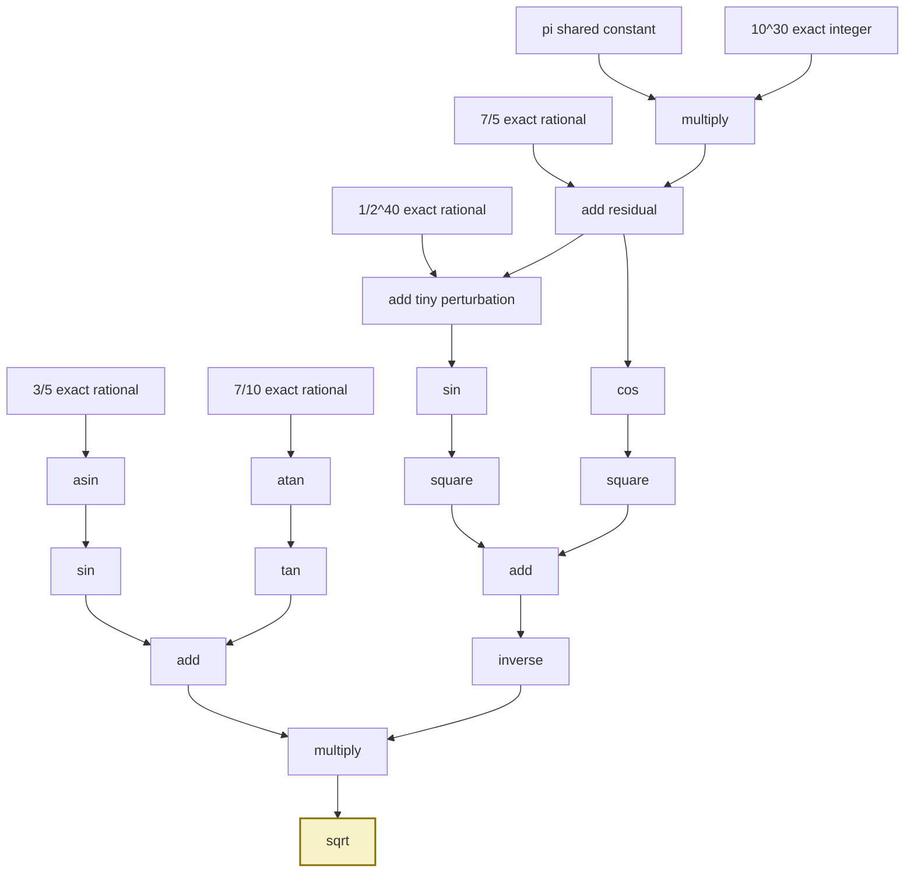
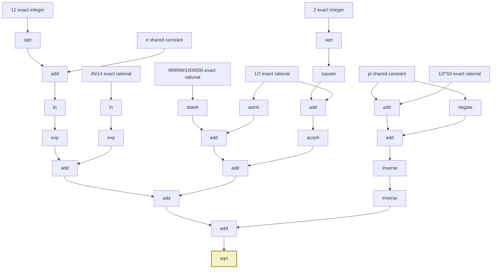
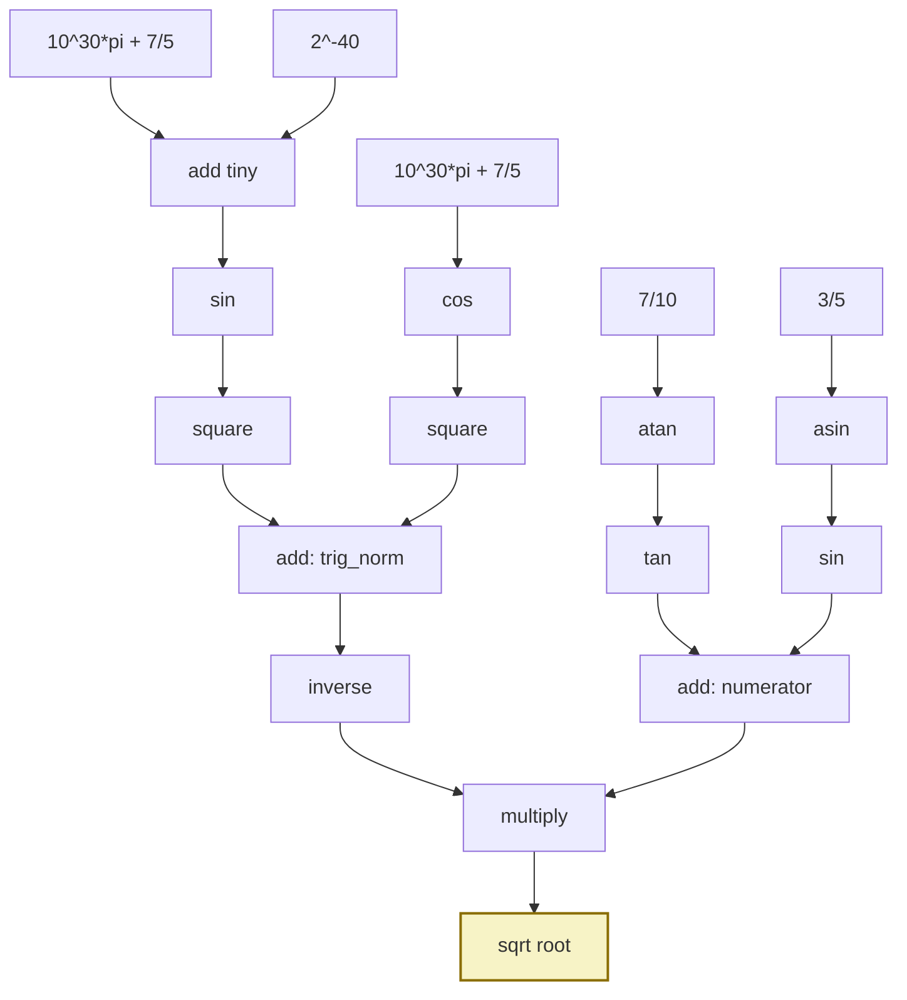
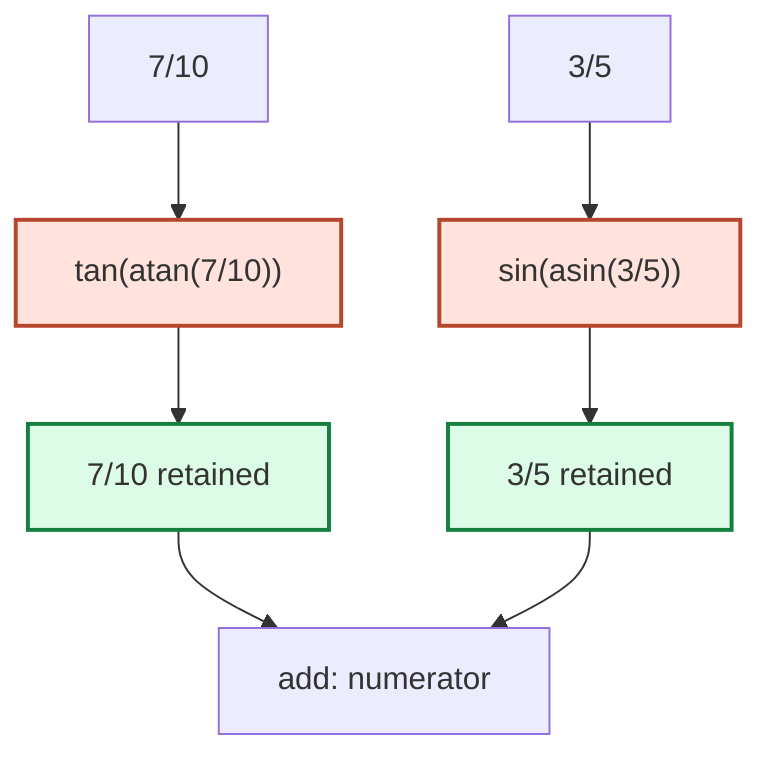
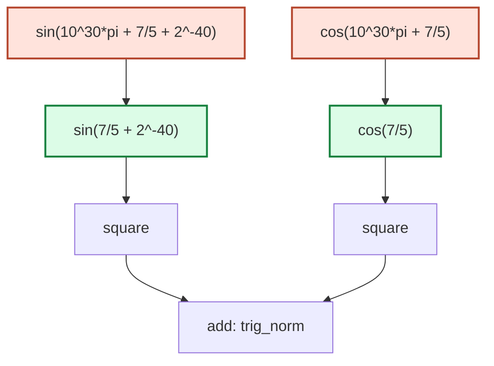

# Computable graph walkthrough

These examples illustrate native scalar construction and query order. Their
Mermaid diagrams record authored operations or fixed explanatory stages, not
the rewritten internal DAG or observed dispatch. Printed comparisons and
repeated samples are observations; neither program contains an independent
oracle or a performance benchmark.

The output below was reproduced on revision
`fad0c11f1` during the documentation audit, using the all-feature build on the
current host. The documentation-only changes preserve both examples' output.
Exact integer samples are not canonical across implementations or cache histories;
completed approximation error, rather than equality of arbitrary sample integers,
is the numerical contract. See the [audit ledger](rustdoc-audit.md) for the
focused validation and independent mathematical enclosure checks.

The generator in [`../../crates/hyperreal/examples/computable_graphs.rs`](../../crates/hyperreal/examples/computable_graphs.rs)
builds intentionally large public `Computable` expressions, emits Mermaid graph
diagrams, and asks each root for an `approx(-80)` value:

```sh
cargo run -p hyperreal --example computable_graphs
```

The generator keeps a tiny parallel graph builder next to the actual
`Computable` values:

```rust
let huge_pi = graph.binary("multiply", &pi, &huge, Computable::multiply);
let phase = graph.binary("add residual", &huge_pi, &seven_fifths, Computable::add);
let phase_plus_tiny = graph.binary("add tiny perturbation", &phase, &tiny, Computable::add);

let sin_phase = graph.unary("sin", &phase_plus_tiny, Computable::sin);
let cos_phase = graph.unary("cos", &phase, Computable::cos);
let atan = graph.unary("atan", &seven_tenths, Computable::atan);
let tan_atan = graph.unary("tan", &atan, Computable::tan);
let asin = graph.unary("asin", &three_fifths, Computable::asin);
let asin_sin = graph.unary("sin", &asin, Computable::sin);

let sin_sq = graph.unary("square", &sin_phase, Computable::square);
let cos_sq = graph.unary("square", &cos_phase, Computable::square);
let trig_norm = graph.binary(
    "add",
    &sin_sq,
    &cos_sq,
    Computable::add,
);
let inverse_norm = graph.unary("inverse", &trig_norm, Computable::inverse);
let numerator = graph.binary("add", &tan_atan, &asin_sin, Computable::add);
let product = graph.binary("multiply", &numerator, &inverse_norm, Computable::multiply);
let root = graph.unary(
    "sqrt",
    &product,
    Computable::sqrt,
);
```

### Argument-reduction tower

This expression stresses large argument reduction and inverse-trig composition:

```text
sqrt((tan(atan(7/10)) + sin(asin(3/5)))
     / (sin(10^30*pi + 7/5 + 2^-40)^2 + cos(10^30*pi + 7/5)^2))
```



Evaluation with `root.approx(-80)` returns the scaled integer
`1378387510292223641544648`, representing roughly:

```text
1.140175425098964290542469
```

The two trig arguments differ by `2^-40`, so their squared sum is not the
identity one. Because `10^30` is even, periodicity removes its pi multiple,
leaving `sin(7/5+2^-40)^2+cos(7/5)^2`. The numerator is mathematically `13/10`.
Native constructors may simplify these expressions before evaluation. A repeated
request can reuse retained samples; the example does not instrument cache hits.

### Cancellation and nested-inverse tower

This expression combines exact square rewrites, logs/exponentials, inverse
hyperbolic functions near difficult points, and a near-cancellation that is
inverted twice:

```text
sqrt(
    exp(ln(sqrt(12) + e))
  + exp(ln(45/14))
  + atanh(999999/1000000)
  + asinh(1/2)
  + acosh(sqrt(2)^2 + 1/2)
  + inverse(inverse(pi + 2^-50 - pi))
)
```



Evaluation with `root.approx(-80)` returns the scaled integer
`5227679412026104074933469`, representing roughly:

```text
4.324235058270604318885090
```

Every source here is in its real domain. The radicand simplifies mathematically
to `sqrt(12)+e+45/14+atanh(999999/1000000)+asinh(1/2)+acosh(5/2)+2^-50`.
In particular, shared pi cancellation can preserve the tiny residual exactly;
the authored inverse nodes do not force numerical evaluation of both inverses.
Kernel guard precision and shared-cache history remain separate from the outer
`-80` request. This example makes no total-work or minimal-precision claim.

### Refinement walk

The generator in
[`../../crates/hyperreal/examples/computable_refinement_steps.rs`](../../crates/hyperreal/examples/computable_refinement_steps.rs)
walks the argument-reduction tower through the public inspection and evaluation
steps:

```sh
cargo run -p hyperreal --example computable_refinement_steps
```

It builds the same shape as the first graph:

```text
sqrt((tan(atan(7/10)) + sin(asin(3/5)))
     / (sin(10^30*pi + 7/5 + 2^-40)^2 + cos(10^30*pi + 7/5)^2))
```

The walkthrough reports exact-leaf facts, sign queries, samples, display,
tolerance comparisons and repeated requests. Queries run in the printed order,
so later observations can consume earlier evidence. Its helpers sometimes build
new root graphs, but process-wide constant caches remain shared. The routine
named `print_facts_only` also calls `sign_until`, which may refine numerically.

The walkthrough prints fixed staged diagrams before the numeric output. Red
and green illustrate mathematical reductions, blue illustrates precision requests,
and purple illustrates a repeated request. These colors and the cache-hit label
are explanatory text, not evidence of a particular runtime path.

Symbolic stage 1 starts with the full expression graph:



Symbolic stage 2 illustrates inverse-function identities. The program checks
them with `compare_absolute(..., -64)`, which can decide through exact structure
or numerical refinement. Its `Equal` result is not generally an exact equality
certificate, and the printed diagram is not a trace of the chosen proof:



Numeric stage 3 illustrates periodic reduction of the huge trigonometric
inputs. The mathematical equivalence is exact; the program's tolerance
comparisons do not count native reduction steps or internal precision:



Numeric stage 4 illustrates precision requests and possible cache reuse.
`approx(p)` returns an integer representing the value in units of `2^p`.
Internal guard precision can be finer, and decimal formatting can warm caches
between printed queries. No minimal-refinement or cache-hit count is asserted:


Observed numeric output for the query order above:

```text
residual 7/5:
  facts: sign=positive, zero=nonzero, exact_rational=true, magnitude=msd 0 (exact=true)
  sign_until(-24): Some(Positive)
  approx(-12): 5734
  approx(-24): 23488102

tiny 2^-40:
  facts: sign=positive, zero=nonzero, exact_rational=true, magnitude=msd -40 (exact=true)
  sign_until(-24): Some(Positive)
  approx(-12): 0
  approx(-24): 0

phase = 10^30*pi + 7/5:
  facts: sign=positive, zero=nonzero, exact_rational=false, magnitude=msd 101 (exact=true)
  zero_status: NonZero
  sign_until(0): Some(Positive)

trig_norm:
  facts: sign=positive, zero=nonzero, exact_rational=false, magnitude=unknown
  sign_until(-24): Some(Positive)
  approx(-12): 4096
  approx(-24): 16777216

numerator:
  facts: sign=unknown, zero=unknown, exact_rational=false, magnitude=unknown
  sign_until(-24): Some(Positive)
  approx(-12): 5325
  approx(-24): 21810381

trig_norm refinement:
  approx( -8) = 256
  approx(-16) = 65536
  approx(-32) = 4294967296
  approx(-64) = 18446744073715171785
  decimal = 1.000000000000304669947723

numerator refinement:
  approx( -8) = 333
  approx(-16) = 85197
  approx(-32) = 5583457485
  approx(-64) = 23980767295822417101
  decimal = 1.300000000000000000000000

product before sqrt:
  facts: sign=positive, zero=nonzero, exact_rational=false, magnitude=unknown
  sign_until(-24): Some(Positive)

root:
  facts: sign=positive, zero=nonzero, exact_rational=false, magnitude=unknown
  sign_until(-24): Some(Positive)

final root:
  approx(-80) = 1378387510292223641544648
  decimal = 1.140175425098964290542469

large-argument reduction checks:
  sin(10^30*pi + 7/5 + 2^-40) vs sin(7/5 + 2^-40): equal within tolerance
  cos(10^30*pi + 7/5) vs cos(7/5): equal within tolerance

inverse-function reduction checks:
  tan(atan(7/10)) vs 7/10: equal within tolerance
  sin(asin(3/5)) vs 3/5: equal within tolerance

cache demonstration:
  first approx(-80) = 1378387510292223641544648
  second approx(-80) = 1378387510292223641544648
```

The coarse samples of `2^-40` are zero at the requested scales while structural
facts retain its positive nonzero value. This is permitted approximation, not
loss of the exact source. Subsequent requests and decimal formatting refine or
reuse evidence according to their own needs; an outer precision request is not
a bound on all nested work.
